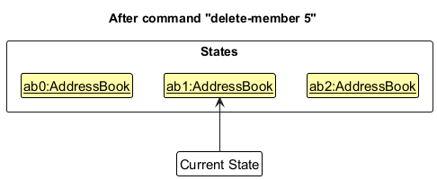
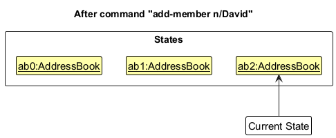

* Table of Contents
{:toc}

--------------------------------------------------------------------------------------------------------------------

## **Acknowledgements**

* _{List the sources of reused or adapted ideas, code, documentation, and third-party libraries here, with links to the originals.}_

--------------------------------------------------------------------------------------------------------------------

## **Setting up, getting started**

Refer to the guide [_Setting up and getting started_](SettingUp.md).

--------------------------------------------------------------------------------------------------------------------

## **Design**

:bulb: **Tip:** The `.puml` files used to create diagrams are in `docs/diagrams`. Refer to the [_PlantUML Tutorial_ at se-edu/guides](https://se-education.org/guides/tutorials/plantUml.html) to learn how to create and edit diagrams.

### Architecture

The ***Architecture Diagram*** given above explains the high-level design of the App.

The following provides a quick overview of the main components and their interactions.

**Main components of the architecture**

**`Main`** (consisting of classes [`Main`](https://github.com/se-edu/addressbook-level3/tree/master/src/main/java/seedu/address/Main.java) and [`MainApp`](https://github.com/se-edu/addressbook-level3/tree/master/src/main/java/seedu/address/MainApp.java)) is in charge of the app launch and shut down.
* At app launch, it initializes the other components in the correct sequence, and connects them up with each other.
* At shut down, it shuts down the other components and invokes cleanup methods where necessary.

The bulk of the app's work is done by the following four components:

* [**`UI`**](#ui-component): The UI of the App.
* [**`Logic`**](#logic-component): The command executor.
* [**`Model`**](#model-component): Holds the data of the App in memory.
* [**`Storage`**](#storage-component): Reads data from, and writes data to, the hard disk.

[**`Commons`**](#common-classes) represents a collection of classes used by multiple other components.

**How the architecture components interact with each other**

The *Sequence Diagram* below shows how the components interact with each other for the scenario where the user issues the command `delete-menu-item c/CR01`. For simplicity, only menu persistence is shown.

Each of the four main components (also shown in the diagram above),

* defines its *API* in an `interface` with the same name as the Component.
* provides its functionality through a concrete `{Component Name}Manager` class that implements the corresponding API interface.

For example, the `Logic` component defines its API in `Logic.java` and implements it in `LogicManager.java`. Other components interact with a component through its interface rather than its concrete class, preventing them from coupling to that component's implementation, as illustrated in the following partial class diagram.

The sections below give more details of each component.

### UI component

The **API** of this component is specified in [`Ui.java`](https://github.com/se-edu/addressbook-level3/tree/master/src/main/java/seedu/address/ui/Ui.java)

The UI consists of a `MainWindow` and its parts, such as `CommandBox`, `ResultDisplay`, `PersonListPanel`, and `StatusBarFooter`. All of these, including `MainWindow`, inherit from the abstract `UiPart` class, which captures common behavior among classes that represent visible GUI parts.

The `UI` component uses the JavaFX UI framework. The layouts of these UI parts are defined in matching `.fxml` files in `src/main/resources/view`. For example, [`MainWindow.fxml`](https://github.com/se-edu/addressbook-level3/tree/master/src/main/resources/view/MainWindow.fxml) specifies the layout of [`MainWindow`](https://github.com/se-edu/addressbook-level3/tree/master/src/main/java/seedu/address/ui/MainWindow.java).

The `UI` component,

* executes user commands using the `Logic` component.
* listens for changes to `Model` data so that the UI can be updated with the modified data.
* keeps a reference to the `Logic` component, because the `UI` relies on the `Logic` to execute commands.
* depends on some classes in the `Model` component because it displays `Person` objects from the model.

### Logic component

**API** : [`Logic.java`](https://github.com/se-edu/addressbook-level3/tree/master/src/main/java/seedu/address/logic/Logic.java)

Here's a (partial) class diagram of the `Logic` component:

The sequence diagram below illustrates the interactions within the `Logic` component, taking `execute("delete-member 1")` API call as an example.

:information_source: **Note:** The lifeline for `DeleteCommandParser` should end at the destroy marker (X), but due to a limitation of PlantUML, it continues to the end of the diagram.

How the `Logic` component works:

1. When `Logic` is called upon to execute a command, the command is passed to an `AddressBookParser` object, which in turn creates a parser that matches the command (e.g., `DeleteCommandParser`) and uses it to parse the command.
1. This results in a `Command` object (more precisely, an object of one of its subclasses e.g., `DeleteCommand`) which is executed by the `LogicManager`.
1. The command can communicate with the `Model` when it is executed (e.g. to delete a person). 
   Note that although this is shown as a single step in the diagram above for simplicity, the code can require several interactions between the command object and the `Model` to complete the operation.
1. The result of the command execution is encapsulated as a `CommandResult` object which is returned from `Logic`.

Here are the other classes in `Logic` (omitted from the class diagram above) that are used for parsing a user command:

How the parsing works:
* When called upon to parse a user command, the `AddressBookParser` class creates an `XYZCommandParser` (`XYZ` is a placeholder for the specific command name, e.g., `AddCommandParser`). The parser uses the other classes shown above to parse the user command and create an `XYZCommand` object (e.g., `AddCommand`). The `AddressBookParser` returns that object as a `Command` object.
* All `XYZCommandParser` classes, such as `AddCommandParser` and `DeleteCommandParser`, implement the `Parser` interface so they can be treated similarly where appropriate, for example during testing.

### Model component
**API** : [`Model.java`](https://github.com/se-edu/addressbook-level3/tree/master/src/main/java/seedu/address/model/Model.java)

The `Model` component,

* stores the address book data i.e., all `Person` objects (which are contained in a `UniquePersonList` object).
* stores each person's name, phone, tags, score, and order history. Editing a person's details preserves
  their existing score and order history.
* stores each person's redeemed milestone rewards in a `RedeemedMilestoneRewardHistory`. The history is immutable:
  adding or deleting a reward returns a new history, and membership checks compare milestone codes.
* stores the `Person` objects selected by the current filter, such as search results, in a separate _filtered_ list. It exposes this list as an unmodifiable `ObservableList<Person>` that the UI can observe and bind to, so the UI updates when the list changes.
* stores a `UserPrefs` object that represents the user’s preferences (currently, just the GUI settings). This is exposed to the outside as a `ReadOnlyUserPrefs` object.
* stores a separate `Menu` in `ModelManager`, alongside `AddressBook` and `UserPrefs`. `Model#getMenu()` exposes a
  `ReadOnlyMenu` with an unmodifiable observable item list; `hasFoodItem` and `addFoodItem` provide menu operations.
* stores a separate `MilestoneCatalog` in `ModelManager`. `Model#getMilestoneCatalog()` exposes a
  `ReadOnlyMilestoneCatalog`, while the existing milestone operations continue to act on the catalog owned by the
  model.
* does not depend on any of the other three components (as the `Model` represents data entities of the domain, they should make sense on their own without depending on other components)

:information_source: **Note:** The alternative, arguably more object-oriented, design below keeps a unique list of tags in `AddressBook`, and each `Person` references tags from that list. This lets `AddressBook` maintain one `Tag` object per unique tag instead of each `Person` holding its own `Tag` objects. 

### Storage component

**API** : [`Storage.java`](https://github.com/se-edu/addressbook-level3/tree/master/src/main/java/seedu/address/storage/Storage.java)

The `Storage` component,
* saves customer records, menu items, milestone rewards, and user preferences in separate JSON files and reads them
  back.
* is implemented by `StorageManager`, which delegates file access to `JsonAddressBookStorage`, `JsonMenuStorage`,
  `JsonMilestoneCatalogStorage`, and `JsonUserPrefsStorage` (one class per data file).

`JsonAdaptedPerson` stores name, phone, tags, score, order history and redeemed milestone reward history. Each stored order includes its item code,
the item name captured when the order was recorded, quantity, recorded time, and `scoreGained`. While redeemed milestone reward history stores milestone,
which consist of its code, reward description and the score needed to redeem the reward.
Unknown JSON properties are ignored when loading and omitted when saving. Older order records require both `itemCode` and
`itemName` before loading; missing `scoreGained` defaults to zero, while negative values are rejected.
A missing score defaults to zero.
* depends on some classes in the `Model` component (because the `Storage` component's job is to save/retrieve objects that belong to the `Model`)

### Common classes

Classes used by multiple components are in the `seedu.address.commons` package.

--------------------------------------------------------------------------------------------------------------------

## **Implementation**

This section describes some noteworthy details on how certain features are implemented.

### Adding a menu item

The `add-menu-item c/CODE n/NAME p/PRICE` command adds a `FoodItem` to the menu owned by `ModelManager`.
The menu is separate from customer records and order histories. `add-order` accepts a menu code and checks for an
exact case-sensitive match in the menu before adding the order. The command copies the matched item's current name
into the new order, alongside its code, quantity, and recorded time. `RecentOrdersPanel` displays the saved name and
points gained, so later menu edits do not change past orders. The command calculates `scoreGained` as
`floor(priceInCents × quantity / 10)` ($1 earns 10 points), saves it with the order, and adds it to the member's
score. The calculation and addition use `long` intermediates before validating the score's nine-digit limit.
`delete-order` selects an order by its history index and subtracts its saved `scoreGained`; it rejects a deletion
that would make the member's score negative. The saved value means a menu price change cannot alter past earnings.

#### Command flow

1. `AddressBookParser` routes the command to `AddMenuItemCommandParser`.
1. The parser checks the required prefixes, rejects duplicates and unexpected preamble text, and validates the code,
   name, and price. Tabs are normalized to spaces for `ArgumentTokenizer`. Unsupported single-letter prefixes and
   control characters other than tabs are rejected before tokenization.
1. The dollar price is converted to integer cents with `BigDecimal#movePointRight(2)` and `intValueExact()`.
   Prices must be positive, have at most two decimal places, and fit in an `int`; no rounding is performed.
1. `AddMenuItemCommand#execute(Model)` checks `Model#hasFoodItem` before calling `Model#addFoodItem`.
   `FoodItem#isSameFoodItem` compares case-sensitive codes, while `equals` compares all three fields.
   Reusing a code throws `CommandException`, leaving the menu unchanged.
1. After execution succeeds, `LogicManager` saves the address book, menu, and milestone catalog in its existing save
   block. It returns the command's success feedback only after all three saves succeed. `ParseException` and command
   execution failures stop before saving; `IOException` during saving is reported as `CommandException`.

#### Data and persistence

`FoodItem` is immutable and holds `code`, `name`, and `priceInCents`. `Menu` uses `UniqueFoodItemList` to enforce
unique case-sensitive codes and preserve insertion order. The three-argument `ModelManager` constructor copies a
loaded `ReadOnlyMenu`; the existing two-argument constructor initializes an empty menu for other callers.

| Class | Responsibility |
|---|---|
| `JsonAdaptedFoodItem` | Converts one item and validates its fields. JSON codes and names must be strings; cents must be an integer in the Java `int` range, then pass the positive-price constraint. |
| `JsonSerializableMenu` | Converts the `foodItems` list, rejecting missing lists, null items, invalid items, and duplicate codes. |
| `JsonMenuStorage` | Reads/writes menu JSON at a configured path. Missing files return `Optional.empty()`; read or validation errors become `DataLoadingException`. |
| `StorageManager` | Delegates `getMenuFilePath`, `readMenu`, and `saveMenu` to `JsonMenuStorage`. |

`MainApp` configures `data/menu.json` relative to the launch directory. Its `initMenu` method loads the saved menu,
uses `SampleDataUtil.getSampleMenu()` if the file is missing, or logs a warning and supplies an empty menu if loading
fails. Sample menu codes match the sample members' order histories. Loading alone leaves an invalid file untouched;
the next successfully executed command other than `help` or `exit` can overwrite it,
matching the existing address-book fallback policy.

All three domain data files are saved after every successfully executed command, including read-only commands
such as `list`, except `help` and `exit`. `LogicManager` returns results requesting help or exit before saving,
so storage failures cannot prevent either action. A save error does not roll back changes already made in memory.
The address-book file is written first, followed by
the menu and milestone catalog, so an earlier file may already be saved if a later write fails; the three writes
are not a transaction. A later successful command other than `help` or `exit` attempts all three saves again
through the same flow. Exiting does not retry domain-data saves, so unsaved in-memory changes are lost on exit.

Each JSON save serializes its contents before writing a unique temporary file in the destination directory.
Only after writing completes does `FileUtil` atomically replace the destination. A failed write or unsupported
atomic replacement leaves the existing destination intact; a failed first save does not leave an empty JSON file.
Missing parent directories are created as needed. Temporary files are removed after saving or failure where
possible; cleanup errors are logged without hiding the save result. There is no non-atomic fallback, so a file
system that cannot atomically replace the destination reports a save error. This protects individual files
against partial writes, but does not provide a transaction across files or guarantee recovery after power loss.

#### Testing

`AddMenuItemCommandTest` isolates command behavior with model stubs. `AddMenuItemCommandParserTest` covers prefix
validation, price boundaries, exact cent conversion, control characters, long inputs, and deterministic generated
inputs. `AddressBookParserTest` checks routing. `ModelManagerTest` checks menu copying and its read-only view.
The JSON adapter, serializable menu, and menu storage test classes cover invalid data and round trips.
`MainAppTest` checks startup fallback and saving/reloading across model initialization; `LogicManagerTest` covers
automatic saving and menu-save errors.

### Milestone catalog and management commands

Milestone rewards are stored in a `MilestoneCatalog` rather than in `AddressBook`. This keeps global loyalty-program
configuration separate from customer records: an address book owns people, while one milestone catalog defines the
rewards available to every customer. `ModelManager` owns both data sources and keeps the existing milestone APIs
stable by delegating them to its catalog.

| Class | Responsibility |
|---|---|
| `MilestoneCatalog` and `ReadOnlyMilestoneCatalog` | Own the sorted, unique milestone list and expose a read-only view to clients. |
| `JsonAdaptedMilestone` | Converts one milestone and validates its code, reward description, and required score. |
| `JsonSerializableMilestoneCatalog` | Converts the `milestones` list, rejecting a missing list, null entries, invalid milestones, and duplicate case-insensitive codes. |
| `JsonMilestoneCatalogStorage` | Reads and writes milestone JSON at a configured path. Missing files return `Optional.empty()`; read or validation errors become `DataLoadingException`. |
| `StorageManager` | Delegates `getMilestoneCatalogFilePath`, `readMilestoneCatalog`, and `saveMilestoneCatalog` to `JsonMilestoneCatalogStorage`. |

`MainApp` configures `data/milestones.json` relative to the launch directory. A valid file is loaded into
`ModelManager`; a missing or invalid file produces an empty catalog, with invalid file contents left untouched until
the next successfully executed command other than `help` or `exit` saves the model.
Legacy `milestones` properties in `memberlist.json` are
ignored, so the address-book file remains responsible only for customer data.

The `list-milestones`, `add-milestone`, `edit-milestone`, and `delete-milestone` commands expose catalog access and
mutation through the CLI. `ListMilestonesCommand` formats `Model#getMilestoneList()` as a numbered list, making the
indexes used by edit and delete discoverable. `AddressBookParser` routes each mutating command to its dedicated
parser. The milestone parsers share strict tokenization that normalizes tabs, rejects unsupported single-letter
prefixes, and rejects control characters other than tabs.

`AddMilestoneCommandParser` requires a reward description and required score in any order. `Milestone` generates a
UUID for its internal code when the parser creates it. The parser passes the milestone to `AddMilestoneCommand`, which
creates a replacement milestone if its code already exists. The UUID is stored with the milestone and redemption
snapshots but omitted from user-facing output.
`EditMilestoneCommandParser` requires a displayed index and at least one editable field; its
`EditMilestoneDescriptor` is defensively copied by `EditMilestoneCommand`. Codes are excluded from the descriptor
because they are stable identities. `DeleteMilestoneCommandParser` accepts only a displayed index. Required scores
are parsed as unsigned decimal digits in the positive Java `int` range, so inputs such as `+500`, `0`, and values
above `2147483647` are rejected.

Edit and delete commands resolve their one-based index against `Model#getMilestoneList()` during execution, then pass
the selected `Milestone` to the model. The catalog uses its case-insensitive code internally and maintains ascending
required-score order with code as the tie-breaker. Editing a required score can therefore change the milestone's
displayed index. None of these commands reads or modifies a person's score or reward-claim records.

The milestone model tests cover validation, sorting, uniqueness, mutation, and read-only views. Command and parser
tests cover numbered listing, empty catalogs, generated code persistence, successful mutations, defensive descriptor copying,
reordered edits, index boundaries, arbitrary prefix order, duplicate and unsupported prefixes, control characters,
and required-score boundaries.
`AddressBookParserTest` checks command routing. The JSON adapter, serializable catalog, storage, `MainApp`, and
`LogicManager` tests cover invalid data, round trips, startup fallback, and automatic saving.

### Deleting a menu item

`AddressBookParser` routes `delete-menu-item c/CODE` to `DeleteMenuItemCommandParser`. The parser requires one
`c/` prefix, rejects preamble text, repeated prefixes, invalid codes, extra arguments, and control characters other
than tabs. It preserves the code's case and constructs `DeleteMenuItemCommand`.

The command finds the exact code through `Model#getMenu()`. A missing code produces `CommandException` before
any mutation. For an existing code, the command passes the actual stored `FoodItem` to `Model#deleteFoodItem`,
which delegates to `Menu#removeFoodItem`. This matters because removal uses full item equality, not only code
identity. The existing `LogicManager` save block persists successful deletions without command-specific changes.
Customer records, order histories, and milestones are unaffected.

`DeleteMenuItemCommandTest` checks deletion, case sensitivity, failure without mutation, and unchanged customer
and milestone data using the real model. Parser tests cover syntax errors and whitespace, and `MainAppTest`
checks that deletion survives saving and reloading and that the deleted code can be reused.

### Redeemed milestone reward history

`RedeemedMilestoneRewardHistory` owns the redeemed milestone rewards belonging to one person. It returns defensive
copies when exposing the list and treats add/delete operations as immutable transformations:

| Operation | Responsibility |
|---|---|
| `addRedeemedMilestoneReward(Milestone)` | Returns a new history containing the milestone, rejecting duplicate codes. |
| `contains(Milestone)` | Checks whether a milestone with the same code has been redeemed. |
| `deleteRedeemedMilestoneReward(Milestone)` | Returns a new history without the milestone with the same code. |

`RedeemMilestoneCommand` validates the person and current milestone indexes, checks score eligibility and duplicate
redemption, then replaces the person with a copy containing the new history. `CancelRedeemCommand` validates the
person and current milestone indexes, checks that the selected milestone is present in the person's history, then
replaces the person with a copy containing the history returned by `deleteRedeemedMilestoneReward(Milestone)`.

Both commands identify the milestone through the current `MilestoneCatalog` index. Consequently, cancelling a
   historical redemption requires the current catalog to contain a milestone with the same code. Deleting the milestone
   makes that historical redemption unavailable to `cancel-redeem` by design; changing other
milestone details while preserving its code does not change its identity.

The command parsers use the shared `m/` prefix and `ParserUtil.parseIndex`, so person and milestone arguments must be
positive integers. `AddressBookParser` routes `redeem` and `cancel-redeem` to their respective parsers.

The related tests cover command success and validation, parser syntax and duplicate prefixes, full parser routing,
immutable history updates, duplicate redemption, absent milestones, and `toString` output.

### \[Proposed\] Undo/redo feature

#### Proposed Implementation

The proposed undo/redo mechanism is facilitated by `VersionedAddressBook`. It extends `AddressBook` with an undo/redo history, stored internally as an `addressBookStateList` and `currentStatePointer`. Additionally, it implements the following operations:

* `VersionedAddressBook#commit()` — Saves the current address book state in its history.
* `VersionedAddressBook#undo()` — Restores the previous address book state from its history.
* `VersionedAddressBook#redo()` — Restores a previously undone address book state from its history.

These operations are exposed in the `Model` interface as `Model#commitAddressBook()`, `Model#undoAddressBook()` and `Model#redoAddressBook()` respectively.

Given below is an example usage scenario and how the undo/redo mechanism behaves at each step.

Step 1. The user launches the application for the first time. The `VersionedAddressBook` will be initialized with the initial address book state, and the `currentStatePointer` pointing to that single address book state.

Step 2. The user executes `delete-member 5` command to delete the 5th person in the address book. The `delete-member` command calls `Model#commitAddressBook()`, causing the modified state of the address book after the `delete-member 5` command executes to be saved in the `addressBookStateList`, and the `currentStatePointer` is shifted to the newly inserted address book state.

Step 3. The user executes `add-member n/David …​` to add a new person. The `add-member` command also calls `Model#commitAddressBook()`, causing another modified address book state to be saved into the `addressBookStateList`.

:information_source: **Note:** If a command fails its execution, it will not call `Model#commitAddressBook()`, so the address book state will not be saved into the `addressBookStateList`.

Step 4. The user now decides that adding the person was a mistake, and decides to undo that action by executing the `undo` command. The `undo` command will call `Model#undoAddressBook()`, which will shift the `currentStatePointer` once to the left, pointing it to the previous address book state, and restores the address book to that state.

:information_source: **Note:** If the `currentStatePointer` is at index 0, pointing to the initial AddressBook state, then there are no previous AddressBook states to restore. The `undo` command uses `Model#canUndoAddressBook()` to check if this is the case. If so, it will return an error to the user rather
than attempting to perform the undo.

The following sequence diagram shows how an undo operation goes through the `Logic` component:

:information_source: **Note:** The lifeline for `UndoCommand` should end at the destroy marker (X), but due to a limitation of PlantUML, it continues to the end of the diagram.

Similarly, how an undo operation goes through the `Model` component is shown below:

The `redo` command does the opposite — it calls `Model#redoAddressBook()`, which shifts the `currentStatePointer` once to the right, pointing to the previously undone state, and restores the address book to that state.

:information_source: **Note:** If the `currentStatePointer` is at index `addressBookStateList.size() - 1`, pointing to the latest address book state, then there are no undone AddressBook states to restore. The `redo` command uses `Model#canRedoAddressBook()` to check if this is the case. If so, it will return an error to the user rather than attempting to perform the redo.

Step 5. The user then decides to execute the command `list`. Commands that do not modify the address book, such as `list`, will usually not call `Model#commitAddressBook()`, `Model#undoAddressBook()` or `Model#redoAddressBook()`. Thus, the `addressBookStateList` remains unchanged.

Step 6. The user executes `clear`, which calls `Model#commitAddressBook()`. Since the `currentStatePointer` is not pointing at the end of the `addressBookStateList`, all address book states after the `currentStatePointer` will be purged. Reason: It no longer makes sense to redo the `add-member n/David …​` command. This is the behavior that most modern desktop applications follow.

The following activity diagram summarizes what happens when a user executes a new command:

#### Design considerations:

**Aspect: How undo & redo execute:**

* **Alternative 1 (current choice):** Saves the entire address book.
  * Pros: Easy to implement.
  * Cons: May have performance issues in terms of memory usage.

* **Alternative 2:** Individual command knows how to undo/redo by
  itself.
  * Pros: Will use less memory (e.g. for `delete-member`, just save the person being deleted).
  * Cons: We must ensure that the implementation of each individual command is correct.

_{more aspects and alternatives to be added}_

### \[Proposed\] Data archiving

_{Explain here how the data archiving feature will be implemented}_

--------------------------------------------------------------------------------------------------------------------

## **Documentation, logging, testing, dev-ops**

* [Documentation guide](Documentation.md)
* [Testing guide](Testing.md)
* [Logging guide](Logging.md)
* [DevOps guide](DevOps.md)

--------------------------------------------------------------------------------------------------------------------

## **Appendix: Requirements**

### Product scope

**Target user profile**:

* A small hawker stall owner who serves many customers and wants to sign up returning customers for a loyalty program.
* Comfortable with CLI and needs to record transactions and retrieve member information quickly during service.

**Value proposition**:

* Keep member, menu, order, and reward information in one desktop application.
* Enter and retrieve information quickly using typed commands and visible records during service.
* Save data locally between sessions.

### User stories

Priorities: High (must have) - `* * *`, Medium (nice to have) - `* *`, Low (unlikely to have) - `*`

| Priority | As …​             | I want to …​                                                         | So that…​                                                                              |
|----------|---------------------|----------------------------------------------------------------------|----------------------------------------------------------------------------------------|
| `* * *`  | a food stall owner   | Sign up a returning customer as a member                             | I can track their orders and rewards in the loyalty program                            |
| `* * *`  | a food stall owner   | Edit a member's name, phone number, or tags                          | I can correct their details and keep their record up to date                           |
| `* * *`  | a food stall owner   | View all members                                                     | I can review and manage my membership records                                          |
| `* * *`  | a food stall owner   | View a member’s details                                              | I can check the member’s contact details and purchase history                          |
| `* * *`  | a food stall owner   | Delete a member                                                      | I can remove duplicate, invalid, or obsolete members                                   |
| `* * *`  | a food stall owner   | Search a member by name or phone number                              | I can quickly retrieve the correct record while serving the member                     |
| `* * *`  | a food stall owner   | Record an order for a member                                         | I can maintain an accurate purchase history                                            |
| `* * *`  | a food stall owner   | Delete an order from a member's order history                        | I can remove an order that was recorded by mistake                                     |
| `* * *`  | a food stall owner   | View a member's membership score                                     | I can check their current progress in the rewards program                              |
| `* * *`  | a food stall owner   | Update a member's membership score manually                          | I can correct their score when an adjustment is needed                                 |
| `* * *`  | a food stall owner   | Store member and order information persistently                      | I do not lose member and order records when the application closes or crashes          |
| `* *`    | a food stall owner   | Have orders automatically update a member's membership score        | I can keep their score consistent when I add or delete orders without calculating adjustments myself |
| `* *`    | a food stall owner   | Create a milestone reward                                            | I can give members an incentive to return                                               |
| `* *`    | a food stall owner   | Edit a milestone reward                                              | I can change its membership score requirement or prize                                 |
| `* *`    | a food stall owner   | Delete a milestone reward                                            | I can stop offering rewards that are no longer available                               |
| `* *`    | a food stall owner   | View all milestone rewards                                           | I can review the rewards currently available to members                                |
| `* *`    | a food stall owner   | View a member's progress and redemption status for milestone rewards | I can tell which rewards they can claim and which they have already claimed            |
| `* *`    | a food stall owner   | Mark an eligible member's milestone reward as redeemed               | I can record that the reward was issued and prevent a duplicate redemption             |
| `* *`    | a food stall owner   | Unmark a member's milestone reward as redeemed                       | I can correct a redemption recorded by mistake                                         |
| `* *`    | a food stall owner   | Store milestone reward data persistently                             | I do not lose reward records when the application closes or crashes                    |
| `* *`    | a new user          | Clear all stored members, menu items, and milestone rewards          | I can replace the sample data with my actual business data                            |
| `* *`    | a new user          | Access the user guide from the application                           | I can look up available commands and their usage                                       |
| `* *`    | a food stall owner   | Exit the application using a typed command                           | I can finish my session without switching to the mouse                                 |
| `* *`    | a food stall owner   | Add a menu item                                                      | I can use that item in orders and award the appropriate membership score                |
| `* *`    | a food stall owner   | Edit a menu item’s details and price                                 | I can use up-to-date item details and prices when recording orders                     |
| `* *`    | a food stall owner   | View all menu items                                                  | I can check the items and prices currently recorded in the application                 |
| `* *`    | a food stall owner   | Delete a menu item                                                   | I can prevent unavailable or discontinued items from being added to new orders         |
| `* *`    | a food stall owner   | Store menu item data persistently                                    | I do not lose menu item records when the application closes or crashes                 |
| `*`      | an experienced user | Create aliases for frequently used commands                          | I can type commands faster and serve more customers                                    |
| `*`      | an experienced user | Undo my most recent reversible command                               | I can recover quickly from an input mistake                                            |
| `*`      | a food stall owner   | Sort menu items by purchase frequency or total revenue               | I can identify popular and high-earning menu items to make informed business decisions |
| `*`      | a food stall owner   | Find members who have not ordered recently                           | I can identify members who may need an incentive to return                             |
| `*`      | a food stall owner   | Export member and order records to a file                            | I can review my business data outside the application                                  |
| `*`      | a food stall owner   | Configure how much orders increase membership score per dollar spent | I can adjust the rewards program to suit my business                                   |

### Use cases

The high-level workflows come first. Underlined UC references indicate included use cases.

### High-level use cases

**UC01: Customer orders food** 
**Software system:** Ratatouille 
**Actor:** Food stall owner

**MSS**

1. User <u>finds the member (UC06)</u>.
2. User <u>records the member's order (UC09)</u>.
3. Ratatouille shows the updated order history and membership score.

   Use case ends.

**Extensions**

* 1a. No matching member is found and the returning customer agrees to sign up.
    * 1a1. User <u>signs up the returning customer (UC07)</u>.

      Use case resumes at step 2.
* 1b. No matching member is found and the customer declines to sign up.
    * 1b1. User serves the customer without recording the order in Ratatouille.

      Use case ends.
* 3a. The member also wants to claim an eligible reward.
    * 3a1. User <u>redeems a milestone reward (UC18)</u>.

      Use case ends.

**UC02: Stall owner corrects a recorded order** 
**Software system:** Ratatouille 
**Actor:** Food stall owner

**MSS**

1. User <u>finds the member (UC06)</u>.
2. User <u>deletes the mistaken order (UC10)</u>.
3. Ratatouille shows the corrected order history and membership score.

   Use case ends.

**Extensions**

* 3a. User needs to record the correct order.
    * 3a1. User <u>records a replacement order (UC09)</u>.

      Use case ends.

**UC03: Stall owner updates a member's record** 
**Software system:** Ratatouille 
**Actor:** Food stall owner

**MSS**

1. User <u>finds the member (UC06)</u>.
2. User <u>edits the member's details (UC08)</u>.
3. Ratatouille shows the updated member record.

   Use case ends.

**Extensions**

* 2a. User needs to correct the membership score instead of the member's details.
    * 2a1. User <u>adjusts the membership score (UC11)</u>.
    * 2a2. Ratatouille shows the updated score.

      Use case ends.

**UC04: Stall owner corrects a reward claim** 
**Software system:** Ratatouille 
**Actor:** Food stall owner

**MSS**

1. User <u>finds the member (UC06)</u>.
2. User <u>cancels the mistaken redemption (UC19)</u>.
3. Ratatouille shows the corrected redemption status.

   Use case ends.

**UC05: Stall owner prepares the app for real use** 
**Software system:** Ratatouille 
**Actor:** Food stall owner

**MSS**

1. User requests to clear the sample data.
2. Ratatouille clears all stored members, menu items, and milestone rewards and confirms the action.
3. User <u>adds a menu item (UC12)</u>.
4. User <u>adds a milestone reward (UC15)</u>.

   Use case ends.

### Detailed use cases

**UC06: Find a member** 
**Software system:** Ratatouille 
**Actor:** Food stall owner

**MSS**

1. User requests a search using one or more name keywords or a valid phone number.
2. Ratatouille shows the matching members.

   Use case ends.

**Extensions**

* 1a. No member matches the search.
    * 1a1. Ratatouille shows an empty result and reports that no members were found.

      Use case ends.
* 1b. Exactly one member matches.
    * 1b1. Ratatouille shows that member and their details.

      Use case ends.
* 1c. User provides no search term.
    * 1c1. Ratatouille reports the required search format.

      Use case ends.

**UC07: Sign up a returning customer as a member** 
**Software system:** Ratatouille 
**Actor:** Food stall owner

**MSS**

1. User provides the returning customer's name and phone number, and optionally tags.
2. Ratatouille adds the member, shows their details, and confirms the addition.

   Use case ends.

**Extensions**

* 1a. Required details are missing or a provided value has an invalid format.
    * 1a1. Ratatouille reports the problem without adding a member.

      Use case ends.
* 1b. A member with the same name already exists.
    * 1b1. Ratatouille reports the duplicate and does not add the member.

      Use case ends.

**UC08: Edit a member's details** 
**Software system:** Ratatouille 
**Actor:** Food stall owner

**MSS**

1. User identifies a member from the current list and supplies a new name, phone number, or tags.
2. Ratatouille updates the supplied details, keeps the member's score, orders, and redeemed rewards, and confirms
   the change.

   Use case ends.

**Extensions**

* 1a. The member identifier does not refer to a member in the current list.
    * 1a1. Ratatouille reports the invalid identifier without changing a member.

      Use case ends.
* 1b. User supplies no changes or a supplied value has an invalid format.
    * 1b1. Ratatouille reports the problem without changing a member.

      Use case ends.
* 1c. The new name belongs to another member.
    * 1c1. Ratatouille reports the duplicate without changing either member.

      Use case ends.

**UC09: Record an order for a member** 
**Software system:** Ratatouille 
**Actor:** Food stall owner

**MSS**

1. User identifies a member from the current list, an existing menu item, and the quantity ordered.
2. Ratatouille records the order, increases the member's membership score using the item's current price and
   quantity, and confirms the result.

   Use case ends.

**Extensions**

* 1a. The member identifier does not refer to a member in the current list.
    * 1a1. Ratatouille reports the invalid identifier without recording an order.

      Use case ends.
* 1b. The item identifier is invalid or does not refer to an existing menu item.
    * 1b1. Ratatouille reports the problem without recording an order.

      Use case ends.
* 1c. The quantity is missing or is not a positive whole number.
    * 1c1. Ratatouille reports the invalid quantity without recording an order.

      Use case ends.
* 1d. The resulting membership score would exceed its allowed maximum.
    * 1d1. Ratatouille reports the score limit without recording the order or changing the member's score.

      Use case ends.

**UC10: Delete an order from a member's history** 
**Software system:** Ratatouille 
**Actor:** Food stall owner

**MSS**

1. User identifies a member from the current list and an order from that member's order history.
2. Ratatouille removes the order, subtracts the score earned by that order from the member's membership score,
   and confirms the deletion.

   Use case ends.

**Extensions**

* 1a. The member identifier does not refer to a member in the current list.
    * 1a1. Ratatouille reports the invalid identifier without deleting an order.

      Use case ends.
* 1b. The order identifier does not refer to an order in that member's history.
    * 1b1. Ratatouille reports the invalid identifier without deleting an order.

      Use case ends.
* 1c. Subtracting the order's earned score would make the member's membership score negative.
    * 1c1. Ratatouille reports the problem and leaves the order and score unchanged.

      Use case ends.

**UC11: Adjust a member's membership score manually** 
**Software system:** Ratatouille 
**Actor:** Food stall owner

**MSS**

1. User identifies a member from the current list and specifies a signed score change.
2. Ratatouille applies the change and shows the previous and new membership scores.

   Use case ends.

**Extensions**

* 1a. The member identifier does not refer to a member in the current list.
    * 1a1. Ratatouille reports the invalid identifier without changing a score.

      Use case ends.
* 1b. The score change is missing or has an invalid format.
    * 1b1. Ratatouille reports the problem without changing the score.

      Use case ends.
* 1c. The result would be negative or exceed the allowed maximum.
    * 1c1. Ratatouille reports the score limit without changing the score.

      Use case ends.

**UC12: Add a menu item** 
**Software system:** Ratatouille 
**Actor:** Food stall owner

**MSS**

1. User supplies a code, name, and price for a new menu item.
2. Ratatouille adds the item to the menu and confirms the addition.

   Use case ends.

**Extensions**

* 1a. A required detail is missing or invalid.
    * 1a1. Ratatouille reports the problem and leaves the menu unchanged.

      Use case ends.
* 1b. Another menu item already uses the code.
    * 1b1. Ratatouille reports the duplicate code and leaves the menu unchanged.

      Use case ends.

**UC13: Edit a menu item** 
**Software system:** Ratatouille 
**Actor:** Food stall owner

**MSS**

1. User identifies an existing menu item by its code and supplies a new code, name, or price.
2. Ratatouille updates the supplied fields and confirms the change. Existing orders retain the details recorded
   when those orders were placed.

   Use case ends.

**Extensions**

* 1a. The given code does not identify a menu item.
    * 1a1. Ratatouille reports that the item does not exist and leaves the menu unchanged.

      Use case ends.
* 1b. User supplies no changes or a new value has an invalid format.
    * 1b1. Ratatouille reports the problem and leaves the menu unchanged.

      Use case ends.
* 1c. The new code belongs to another menu item.
    * 1c1. Ratatouille reports the duplicate code and leaves the menu unchanged.

      Use case ends.

**UC14: Delete a menu item** 
**Software system:** Ratatouille 
**Actor:** Food stall owner

**MSS**

1. User identifies a menu item by its code and requests deletion.
2. Ratatouille removes the item and confirms the deletion. Existing member orders remain unchanged.

   Use case ends.

**Extensions**

* 1a. The supplied code has an invalid format.
    * 1a1. Ratatouille reports the problem and leaves the menu unchanged.

      Use case ends.
* 1b. No menu item has the supplied code.
    * 1b1. Ratatouille reports that the item does not exist and leaves the menu unchanged.

      Use case ends.

**UC15: Add a milestone reward** 
**Software system:** Ratatouille 
**Actor:** Food stall owner

**MSS**

1. User supplies a reward description and required membership score.
2. Ratatouille adds the milestone to the reward catalog and confirms the addition.

   Use case ends.

**Extensions**

* 1a. A required detail is missing or invalid.
    * 1a1. Ratatouille reports the problem and leaves the catalog unchanged.

      Use case ends.

**UC16: Edit a milestone reward** 
**Software system:** Ratatouille 
**Actor:** Food stall owner

**MSS**

1. User identifies a milestone from the current catalog and supplies a new reward description or required
   membership score.
2. Ratatouille updates the supplied details and confirms the change. A changed requirement may alter the
   milestone's position in the catalog.

   Use case ends.

**Extensions**

* 1a. The identifier does not refer to a milestone in the current catalog.
    * 1a1. Ratatouille reports the invalid identifier without changing a milestone.

      Use case ends.
* 1b. User supplies no changes or a supplied value has an invalid format.
    * 1b1. Ratatouille reports the problem without changing a milestone.

      Use case ends.

**UC17: Delete a milestone reward** 
**Software system:** Ratatouille 
**Actor:** Food stall owner

**MSS**

1. User identifies a milestone from the current catalog and requests deletion.
2. Ratatouille removes the milestone and confirms the deletion. Member scores and recorded redemptions remain
   unchanged.

   Use case ends.

**Extensions**

* 1a. The identifier does not refer to a milestone in the current catalog.
    * 1a1. Ratatouille reports the invalid identifier and leaves the catalog unchanged.

      Use case ends.

**UC18: Redeem a milestone reward for a member** 
**Software system:** Ratatouille 
**Actor:** Food stall owner

**MSS**

1. User identifies a member from the current list and a milestone from the current catalog to redeem.
2. Ratatouille records the redemption and confirms it. The member's membership score stays unchanged.

   Use case ends.

**Extensions**

* 1a. Either identifier does not refer to a current member or milestone.
    * 1a1. Ratatouille reports the invalid identifier without recording a redemption.

      Use case ends.
* 1b. The member's membership score is below the milestone's requirement.
    * 1b1. Ratatouille reports insufficient score without recording a redemption.

      Use case ends.
* 1c. The member has already redeemed that milestone.
    * 1c1. Ratatouille reports the existing redemption without changing the member.

      Use case ends.

**UC19: Cancel a member's milestone redemption** 
**Software system:** Ratatouille 
**Actor:** Food stall owner

**MSS**

1. User identifies a member from the current list and a redeemed milestone still present in the current catalog.
2. Ratatouille removes that redemption and confirms the cancellation. The member's membership score stays unchanged.

   Use case ends.

**Extensions**

* 1a. Either identifier does not refer to a current member or milestone.
    * 1a1. Ratatouille reports the invalid identifier without cancelling a redemption.

      Use case ends.
* 1b. The member has not redeemed the selected milestone.
    * 1b1. Ratatouille reports that there is no redemption to cancel and leaves the member unchanged.

      Use case ends.

### Non-Functional Requirements

1.  Should work on Windows, Linux, and macOS computers with Java `25` or above installed.
2.  Should support up to 1000 members and their associated records without noticeable sluggishness during typical usage.
3.  A user with above average typing speed for regular English text (i.e. not code, not system admin commands) should be able to accomplish most of the tasks faster using commands than using the mouse.
4.  Should be portable and work without requiring installation. It should be distributed as a single JAR file, or as a single ZIP file if additional files are required.
5.  Should operate as a single-user application without depending on a remote server or a database management system.
6.  Should store member, order, and membership data locally in a human-editable text file.
7.  Should save changes made by successful data-modifying commands automatically. A failed command or save operation should not corrupt previously saved data.
8.  Common commands, such as finding a member, recording an order, and updating membership points, should complete without noticeable delay under typical usage.
9.  Invalid commands should provide clear error messages that identify the problem without modifying existing data.

### Glossary

* **Customer**: Anyone who buys food from the stall. A customer is not tracked by Ratatouille unless they sign up as a *member*.
* **Hawker centres**: Open-air food complexes in Singapore housing many small, independently run food stalls.
* **Member**: A customer enrolled in the stall's *rewards program*, uniquely identified by their *Singapore phone number*.
* **Membership points**: A non-negative whole number representing a member's standing in the rewards program, used to determine eligibility for *milestone rewards*.
* **Rewards program**: The stall's loyalty scheme, in which members accumulate *membership points* and redeem them for *milestone rewards*.
* **Menu item**: A dish or drink sold by the stall, recorded with a unique case-sensitive code, name, and price.
* **Milestone reward**: A prize a member becomes eligible for upon reaching a set number of membership points. Each milestone reward can be claimed at most once per member.
* **Order**: A record of a menu item's code and name, quantity, time recorded, and points earned, stored in a
  member's order history.
* **Order history**: All orders recorded for a member. Also referred to as *purchase history*.
* **Reversible command**: A command that changes stored data and can therefore be undone (e.g. `add-order`). Commands that only read or display data (e.g. `find`) or close the app (`exit`) are not reversible.
* **Sample data**: Placeholder members loaded when Ratatouille is launched for the first time, so new users can try out commands.
* **Singapore phone number**: An 8-digit number starting with 6, 8 or 9, with no spaces, dashes or country code (e.g. `91234567`).
* **Stall owner**: The main user of Ratatouille, who runs a food stall at a hawker centre. Also covers staff operating the app on the owner's behalf.

--------------------------------------------------------------------------------------------------------------------

## **Appendix: Instructions for manual testing**

Given below are instructions to test the app manually.

:information_source: **Note:** These instructions only provide a starting point for testers to work on;
testers are expected to do more *exploratory* testing.

### Launch and shutdown

1. Initial launch

   1. Download the JAR file and copy it into an empty folder.

   1. Double-click the JAR file. 
      Expected: The GUI opens with a set of sample contacts. The window size may not be optimal.

1. Saving window preferences

   1. Resize the window to an optimal size. Move the window to a different location. Close the window.

   1. Relaunch the app by double-clicking the JAR file. 
       Expected: The most recent window size and location are retained.

1. _{ more test cases …​ }_

### Deleting a member

1. Deleting a person while all persons are being shown

   1. Prerequisites: List all persons using the `list` command, with multiple persons in the list.

   1. Test case: `delete-member 1` 
      Expected: The first contact is deleted from the list. The status message shows the deleted contact's details.

   1. Test case: `delete-member 0` 
      Expected: No person is deleted. The status message shows error details.

   1. Other incorrect delete commands to try: `delete-member`, `delete-member x`, `...` (where x is larger than the list size) 
      Expected: Similar to previous.

1. _{ more test cases …​ }_

### Recording an order

1. Recording an order for a person in the displayed list

   1. Prerequisites: Use `list` to show at least one person. The sample menu contains `1` (Chicken Rice),
      `3A` (Nasi Lemak), and `3B` (Nasi Lemak + Chicken).

   1. Test case: `add-order 1 o/1 q/2` 
      Expected: The status message confirms the order was added to the first person's order history. Their score
      increases by 90 points. The full person list is shown.

   1. Close and reopen the app, then enter `add-order 1 o/3B q/1`. 
      Expected: The status message shows both the earlier Chicken Rice order and the new Nasi Lemak + Chicken order
      in the first person's order history. The new order adds 65 points to their score.

   1. Test case: `add-order 1 o/Chicken-Rice q/2` 
      Expected: The item-code constraint is shown, and no order is added.

   1. Test case: `add-order 1 o/UNKNOWN q/2` 
      Expected: The unknown-menu-code error is shown, and no order is added.

   1. Test case: `add-order 1 o/1 q/0` 
      Expected: The quantity constraint is shown, and no order is added.

### Deleting an order

1. Deleting an order from a person in the displayed list

   1. Prerequisites: Use `list` to show at least one person with an order history. If needed, enter
      `add-order 1 o/1 q/2` and `add-order 1 o/3B q/1` first; both codes are in the sample menu.

   1. Test case: `delete-order 1 o/2` 
      Expected: The status message confirms that the second order was deleted. The first order remains, and the full
      person list is shown. The person's score decreases by the deleted order's saved `scoreGained`.

   1. Close and reopen the app after the successful deletion. 
      Expected: The deleted order remains absent from the person's order history.

   1. Test case: `delete-order 1 o/999` 
      Expected: The order-index error is shown, and no order is deleted.

   1. Test case: `delete-order 999 o/1` 
      Expected: The person-index error is shown, and no order is deleted.

   1. Other incorrect delete-order commands to try: `delete-order`, `delete-order 1`,
      `delete-order 1 o/0`, `delete-order 1 o/x`. 
      Expected: The command-format error is shown, and no order is deleted.

### Adding a menu item

Use a disposable app home folder for these tests. Start with no `data/menu.json`; the sample menu loads.

1. Test case: `add-menu-item c/12A n/Dessert p/3.50` 
   Expected: `New menu item added: Dessert`. `data/menu.json` contains the item with `priceInCents` of `350`.
1. Close and reopen the app, then enter `add-menu-item c/12A n/Different Dish p/5.00`. 
   Expected: `A menu item with this code already exists.` The original item's name and price remain unchanged.
1. Test case: `add-menu-item p/0.01 c/12a n/Coffee` 
   Expected: The item is added at one cent. The lowercase code is distinct from `12A`.
1. Test case: `add-menu-item c/13 n/Dish` 
   Expected: The usage message is shown for the missing price. No item is added.
1. Test cases: `add-menu-item c/13 n/Dish p/0`, `add-menu-item c/13 n/Dish p/4.501`,
   `add-menu-item c/13 n/Dish p/21474836.48`. 
   Expected: The price constraint is shown, no item is added, and saved files are unchanged.
1. Test case: `add-menu-item c/13 n/Dish n/Other p/4.50` 
   Expected: A duplicate-prefix error is shown and the menu remains unchanged.
1. Test case: `add-menu-item c/13 n/Dish x/extra p/4.50` 
   Expected: The command-format error is shown and the menu remains unchanged.

### Deleting a menu item

1. In a disposable app home folder, add `add-menu-item c/DEL01 n/Test Dish p/4.50` and
   `add-menu-item c/del01 n/Other Dish p/5.00`.
1. Run `delete-menu-item c/DEL01`. 
   Expected: `Deleted menu item: DEL01 (Test Dish)`. The `del01` item remains in `data/menu.json`.
1. Close and reopen the app, then run `delete-menu-item c/DEL01` again. 
   Expected: `No menu item with this code exists.` The remaining menu is unchanged.
1. Run `delete-menu-item c/del01`. 
   Expected: The remaining test item is deleted. The sample menu items remain unchanged.
1. Try `delete-menu-item`, `delete-menu-item c/`, and `delete-menu-item c/DEL01 c/DEL02`. 
   Expected: An input error is shown, and no data is changed or saved.

### Managing milestone rewards

Use a disposable app home folder for these tests. Start with no `data/milestones.json`. The milestone list is sorted
by required score; equal-score order is arbitrary.

1. Test case: `list-milestones` before adding a milestone 
   Expected: `No milestones found.`
1. Test case: `add-milestone r/Free drink s/500` 
   Expected: `New milestone added: Free drink (Required score: 500)` and `data/milestones.json` contains the
   milestone with a generated internal code.
1. Test case: `add-milestone s/1000 r/$10 voucher` 
   Expected: The milestone is added even though the prefixes are in a different order.
1. Test case: `list-milestones` 
   Expected: Both milestones are shown with numbered indexes and no codes. The drink appears first because its
   required score is lower.
1. Test case: `add-milestone r/Free drink s/500` again 
   Expected: A second milestone is added with a different internal code.
1. Test cases: `add-milestone r/Reward s/+500`, `add-milestone r/Reward s/0`, and
   `add-milestone r/Reward s/2147483648`. 
   Expected: The required-score constraint is shown and no milestone is added.
1. Test case: `edit-milestone 1 r/Free drink and snack s/1500` 
   Expected: The milestone retains its generated code, both editable fields change, and it moves after the voucher in
   the sorted list.
1. Test case: `edit-milestone 1 c/NEWCODE` 
   Expected: The command-format error is shown because internal codes cannot be edited.
1. Test case: `delete-milestone 1` 
   Expected: The milestone currently shown at index 1 is deleted without changing member scores.
1. Test cases: `edit-milestone 999 r/Reward` and `delete-milestone 999`. 
   Expected: The milestone-index error is shown and the catalog remains unchanged.
1. Close and reopen the app. 
   Expected: Added and edited milestones remain, and deleted milestones remain absent.

### Saving data

1. Missing or invalid menu files, using a disposable app home folder

   1. With the app closed, move `data/menu.json` outside the `data` folder. Start the app. 
      Expected: The sample menu loads. Enter `list`; a new `data/menu.json` with the sample items is saved.
   1. Close the app and replace `data/menu.json` with malformed JSON or `{"foodItems":[null]}`. Restart. 
      Expected: A loading warning is logged and the menu starts empty. The invalid file is unchanged until a
      command executes successfully. Running `list` replaces it with valid empty-menu JSON.

1. Dealing with missing/corrupted data files

   1. _{Explain how to simulate missing or corrupted data files and state the expected behavior.}_

1. _{ more test cases …​ }_
