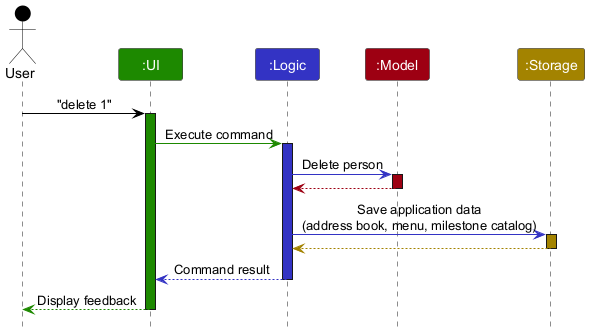
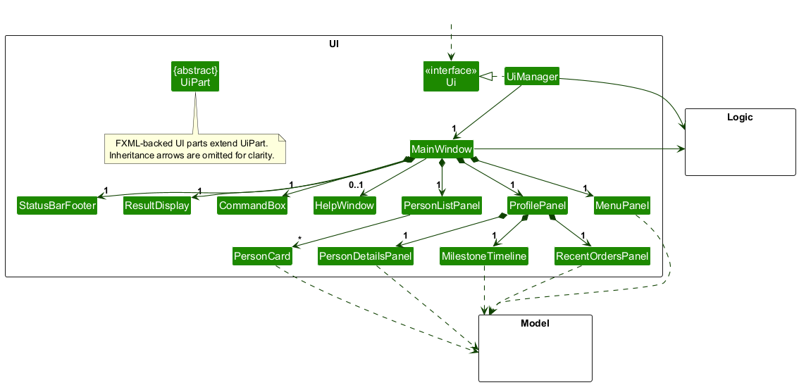
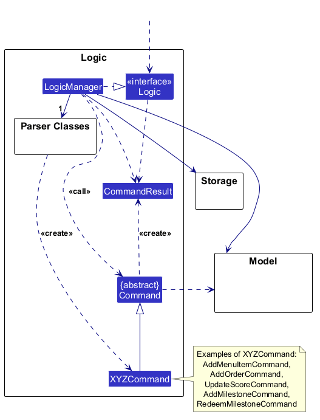
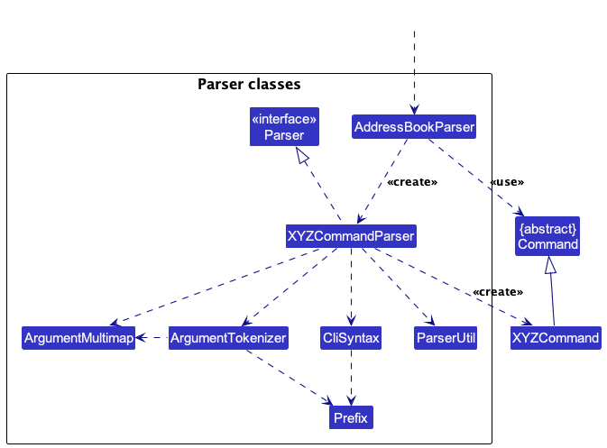
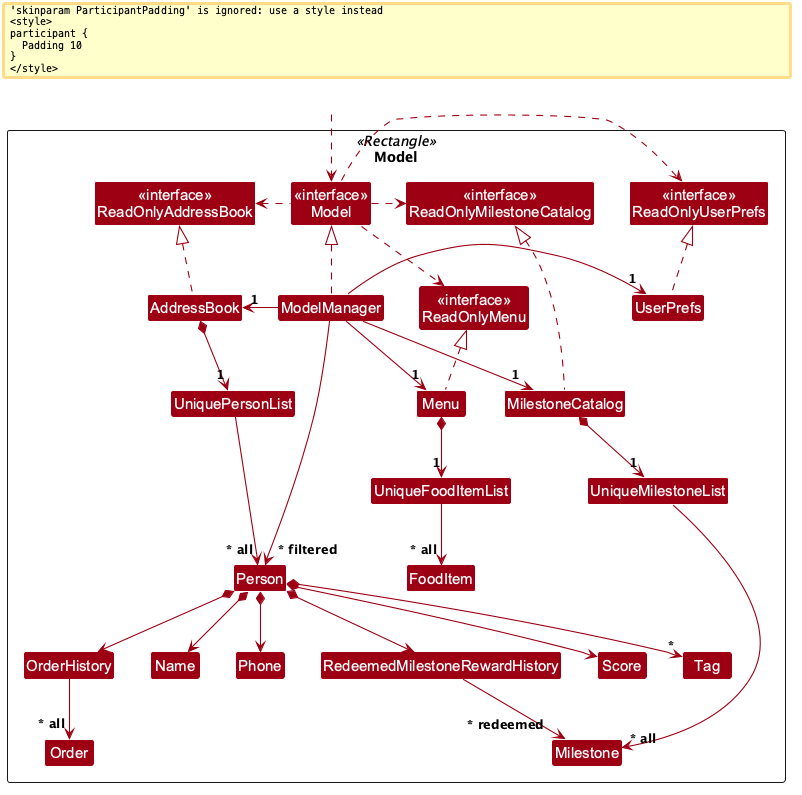
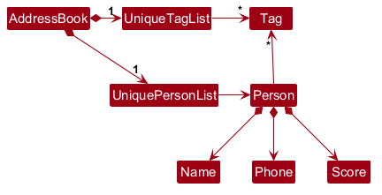
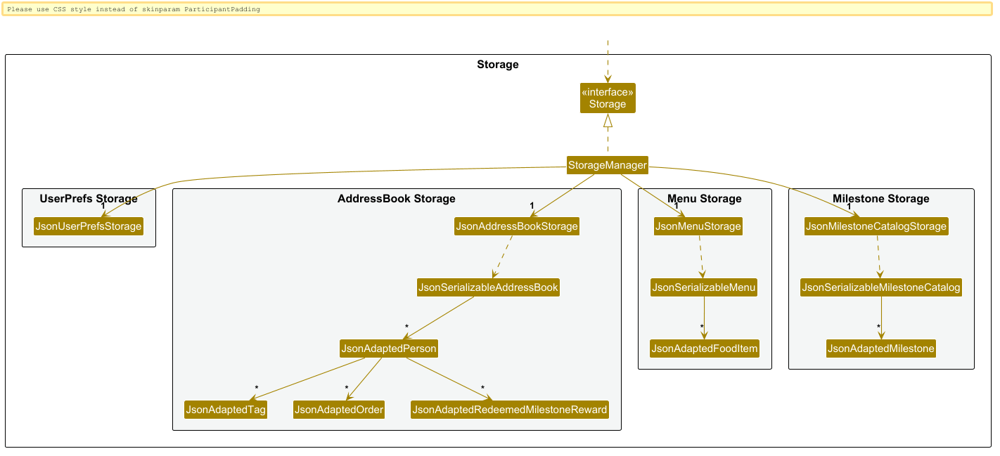

* Table of Contents
{:toc}

--------------------------------------------------------------------------------------------------------------------

## **Acknowledgements**

Ratatouille is built on [AddressBook-Level3 (AB3)](https://github.com/se-edu/addressbook-level3) by the [SE-EDU initiative](https://se-education.org). We adapted its codebase, application architecture, and developer documentation for Ratatouille.

The project uses the following third-party libraries and tools:

* [JavaFX](https://openjfx.io/) for the graphical user interface.
* [Jackson](https://github.com/FasterXML/jackson) for reading and writing JSON data.
* [JUnit 5](https://docs.junit.org/5.14.4/) for automated testing.
* [PlantUML](https://plantuml.com/) for generating UML diagrams.

--------------------------------------------------------------------------------------------------------------------

## **Setting up, getting started**

Refer to the guide [_Setting up and getting started_](SettingUp.md).

--------------------------------------------------------------------------------------------------------------------

## **Design**

:bulb: **Tip:** The `.puml` files used to create diagrams are in `docs/diagrams`. Refer to the [_PlantUML Tutorial_ at se-edu/guides](https://se-education.org/guides/tutorials/plantUml.html) to learn how to create and edit diagrams.

### Architecture

The ***Architecture Diagram*** given above explains the high-level design of the App.

The following provides a quick overview of the main components and their interactions.

**Main components of the architecture**

**`Main`** (consisting of classes [`Main`](https://github.com/AY2627S1-CS2103T-F12-3/tp/blob/master/src/main/java/seedu/address/Main.java) and [`MainApp`](https://github.com/AY2627S1-CS2103T-F12-3/tp/blob/master/src/main/java/seedu/address/MainApp.java)) manages the application's lifecycle:

* At startup, it loads stored data and user preferences, initializes the components, and connects them.
* At shutdown, it saves user preferences, including GUI settings.

The application's functionality is organized into four components:

* [**`UI`**](#ui-component): Displays application data and accepts user commands.
* [**`Logic`**](#logic-component): Parses and executes commands, and coordinates saving application data.
* [**`Model`**](#model-component): Holds member records, menu items, the milestone catalog, and user preferences in memory.
* [**`Storage`**](#storage-component): Reads and writes application data and user preferences in JSON files.

[**`Commons`**](#common-classes) provides shared utilities and supporting classes.

**How the architecture components interact with each other**

The sequence diagram below illustrates a successful execution of `delete-menu-item c/CR01`, assuming that the menu contains an item with code `CR01` and saving succeeds. Interactions within each component are abstracted away. For clarity, only menu persistence is shown; saving member data and the milestone catalog is omitted.

Each of the four main components exposes an API through an interface: `Ui`, `Logic`, `Model`, or `Storage`. The corresponding implementation classes are `UiManager`, `LogicManager`, `ModelManager`, and `StorageManager`.

The partial class diagram below illustrates this arrangement. `LogicManager` implements `Logic` and holds references to the `Model` and `Storage` interfaces, reducing its dependence on their concrete implementations.

The sections below give more details of each component.

### UI component

The **API** of this component is specified in [`Ui.java`](https://github.com/AY2627S1-CS2103T-F12-3/tp/blob/master/src/main/java/seedu/address/ui/Ui.java).

The UI uses JavaFX. `UiManager` creates and displays `MainWindow`, which contains the command box, result display, member list, member profile, menu panel, and status bar. `MainWindow` also manages a separate help window.

`ProfilePanel` groups the selected member's details, milestone progress, and recent orders through `PersonDetailsPanel`, `MilestoneTimeline`, and `RecentOrdersPanel`.

FXML-backed UI parts extend the abstract `UiPart` class, with layout files in `src/main/resources/view`. For example, [`MainWindow.fxml`](https://github.com/AY2627S1-CS2103T-F12-3/tp/blob/master/src/main/resources/view/MainWindow.fxml) defines the layout of [`MainWindow`](https://github.com/AY2627S1-CS2103T-F12-3/tp/blob/master/src/main/java/seedu/address/ui/MainWindow.java). `PersonDetailsPanel` and `MilestoneTimeline` are constructed in Java and extend `VBox` and `ScrollPane`, respectively.

The `UI` component:

* passes user commands to `Logic` and displays command feedback.
* obtains observable member and menu lists through `Logic`, allowing their list views to update when the lists change.
* refreshes the member profile after command execution, including when a command fails.
* uses model types to display member details, menu items, milestones, and recent orders.

### Logic component

**API** : [`Logic.java`](https://github.com/AY2627S1-CS2103T-F12-3/tp/blob/master/src/main/java/seedu/address/logic/Logic.java)

`LogicManager` coordinates command parsing, execution, and persistence. In the partial class diagram below, `XYZCommand` represents a concrete command, and Parser Classes groups the parsing classes; `LogicManager` holds one `AddressBookParser` instance.

The sequence diagram below illustrates parsing and execution for a successful `delete-member 1` command.

`personToDelete` is the `Person` retrieved at the displayed index. The diagram omits this lookup, clearing the selection when the deleted member is selected, and the persistence steps below; its parser destroy marker does not represent an explicit operation in the code.

How the `Logic` component works:

1. **Parse:** `AddressBookParser` identifies the command word and delegates argument parsing to a matching parser, or directly creates commands such as `help`, `exit`, and `list`.
1. **Execute:** `LogicManager` calls `Command.execute(model)`, which reads or updates `Model` and returns a `CommandResult`.
1. **Save:** Unless the result requests help or exit, `LogicManager` saves member data, the menu, and the milestone catalog through `Storage`, even if the command did not change them.
1. **Return:** After any required saves succeed, the result is returned to the UI. Parsing failures raise `ParseException`; execution and storage I/O failures are reported through `CommandException`. A save failure does not roll back model changes or earlier successful file writes.

The following partial diagram summarizes the parsing classes. Individual parsers use only the helpers they need.

Concrete command parsers implement `Parser<T extends Command>` and construct their corresponding commands. For prefix-based arguments, `ArgumentTokenizer` uses `Prefix` constants from `CliSyntax` to produce an `ArgumentMultimap`. `ParserUtil` provides shared conversions and validation, such as parsing displayed indices.

### Model component
**API** : [`Model.java`](https://github.com/AY2627S1-CS2103T-F12-3/tp/blob/master/src/main/java/seedu/address/model/Model.java)

`ModelManager` implements `Model` and holds the application's data in memory, independently of the UI, Logic, and Storage components. The partial diagram above is supplemented by the menu, milestone, and member-history structures described below.

* **Members:** `AddressBook` contains a `UniquePersonList`. Each `Person` holds a name, phone entry, tags, score, order history, and redeemed milestone reward history. Both histories are immutable; updates create replacement histories.
* **Menu and milestones:** Separate `Menu` and `MilestoneCatalog` objects store food items and reward definitions, exposed through `ReadOnlyMenu` and `ReadOnlyMilestoneCatalog` with unmodifiable observable lists. The menu and catalog are shared across members, while order and redeemed reward histories belong to individual members.
* **Display state:** A `FilteredList<Person>` provides an unmodifiable observable view of members matching the current filter. The selected member is stored separately as a snapshot; replacing a member does not automatically update that selection. Commands that display the updated member explicitly call `selectPerson(updatedPerson)`.
* **Preferences:** `UserPrefs` stores GUI settings and is exposed through `ReadOnlyUserPrefs`.

**Member identity and phone matching**

`Person.isSamePerson` identifies members by equal saved phone entries, allowing different members to share a name. `UniquePersonList` uses this identity check to reject duplicate members when adding or replacing entries. `Phone` normalizes recognized Singapore formats to eight digits; other nonblank entries retain their spelling apart from surrounding whitespace and use exact, case-sensitive equality. New phone entries supplied through commands must contain a decimal digit, while legacy digitless entries remain readable for lookup and correction.

`findPersonByPhone` searches the full member list for an exact phone match. `findPersonsWithSimilarPhone` separately finds different entries that may contain a common number using `Phone.hasPossibleNumberInCommon`. These potential matches are advisory: they do not establish duplicate identity or change the filter or selection.

:information_source: **Note:** The diagram below shows an alternative tag design, not the current implementation. It centralizes tags in `AddressBook`; currently, each `Person` holds its own set of tags. 

### Storage component

**API** : [`Storage.java`](https://github.com/AY2627S1-CS2103T-F12-3/tp/blob/master/src/main/java/seedu/address/storage/Storage.java)

`StorageManager` implements `Storage` and delegates JSON file access to four classes:

* `JsonAddressBookStorage`: Member records, including scores, order histories, and redeemed reward histories.
* `JsonMenuStorage`: Menu items.
* `JsonMilestoneCatalogStorage`: Milestone reward definitions.
* `JsonUserPrefsStorage`: User preferences.

The domain storage classes use JSON adapters to convert between stored data and model objects, validating fields during loading. Orders retain their recorded item name and points earned, while redeemed rewards retain milestone details. Missing member scores and order `scoreGained` values default to zero; unknown JSON properties are ignored and are not preserved on saving.

Missing files return `Optional.empty()`, while read or validation failures are reported through `DataLoadingException`. Writes use `JsonUtil` and `FileUtil` to atomically replace each destination file after writing a temporary file; failures are reported through `IOException`. This protects individual files from partial writes, but saving multiple files is not a transaction.

### Common classes

The `seedu.address.commons` package provides shared support classes: `LogsCenter` configures logging, `GuiSettings` represents window settings, and `Index` converts between one-based displayed indices and zero-based indices. Utility classes include `JsonUtil` for JSON conversion, `FileUtil` for file access, and validation helpers such as `AppUtil` and `CollectionUtil`. Shared exceptions include `DataLoadingException` and `IllegalValueException`.

--------------------------------------------------------------------------------------------------------------------

## **Implementation**

This section explains selected implementation details, focusing on data identity, historical records, score updates, and persistence.

### Menu item management

The class diagram in [Model component](#model-component) shows how the shared menu relates to member records and their histories.

The menu is shared by all members and stored separately from their order histories. Each immutable `FoodItem` contains a code, name, and price in integer cents. `Menu` uses `UniqueFoodItemList` to enforce unique, case-sensitive codes and preserve insertion order. Prices are converted exactly from decimal input to integer cents to avoid rounding errors; they must be positive, have at most two decimal places, and fit in a Java `int`.

`AddressBookParser` delegates menu commands to their dedicated parsers, which validate arguments before constructing commands. For `add-menu-item c/CODE n/NAME p/PRICE`, `AddMenuItemCommand` checks for an existing code before adding the item through the model. A duplicate code causes a `CommandException` without changing the menu.

For `delete-menu-item c/CODE`, `DeleteMenuItemCommand` resolves the case-sensitive code to the stored `FoodItem` before passing it to `Model#deleteFoodItem`. This is necessary because removal compares the full item, whereas lookup identifies it by code. A missing code is rejected before mutation. Deleting a menu item leaves existing orders unchanged because each order stores its own historical item details.

Tests cover duplicate and case-sensitive codes, exact price conversion, invalid arguments, and deletion without changes to member or milestone data.

### Order recording and score updates

`AddOrderCommand` resolves the supplied menu code using an exact, case-sensitive match. The new `Order` stores the item's current name and code, quantity, recorded time, and earned points (`scoreGained`). Saving these values with the order preserves its historical details when the menu is later edited or an item is deleted.

Earned points are calculated as `floor(priceInCents × quantity / 10)`, equivalent to 10 points per dollar. The calculation and addition to the member's score use `long` intermediates. The command rejects an order if its earned points or the resulting member score exceeds `999999999`, then replaces the member with a copy containing the updated score and order history.

`DeleteOrderCommand` selects the member from the filtered member list and converts the displayed newest-first order index to the oldest-first index used by `OrderHistory`. It subtracts the selected order's saved `scoreGained`, rejecting the deletion if the resulting score would be negative. The order removal and score change are applied together by replacing the member.

**Example:** An order for two items priced at $4.80 each earns 96 points. Changing the menu price to $5.00 does not change that order's saved earnings. Deleting the old order subtracts 96 points, provided the member's current score is at least 96.

Tests cover score reversal, rejection of deletions that would produce negative scores, and selection of the correct member from a filtered list.

### Milestone catalog management

See the class diagram in [Model component](#model-component) for the catalog structure and its relationship to members' redemption histories.

`MilestoneCatalog` stores the rewards available to all members, separately from the member records in `AddressBook`. `ModelManager` delegates catalog operations to it and exposes an unmodifiable observable list through `ReadOnlyMilestoneCatalog`.

Each milestone has an internal, nonblank code that is persisted but omitted from user-facing output. `add-milestone` generates this code as a UUID, while sample and loaded milestones may use other nonblank codes. Codes are compared case-insensitively and remain unchanged when a milestone is edited, so identity does not depend on its reward description, required score, or displayed index. The catalog sorts milestones by ascending required score, using code as the tie-breaker.

`list-milestones` displays the numbered catalog. Add commands require a reward description and a positive required score no greater than `999999999`. Edit commands require a displayed index and at least one editable field; delete commands require a displayed index. Edit and delete resolve their index against the current catalog during execution. Editing a required score can therefore change a milestone's displayed index. Catalog changes do not modify members' scores or existing redemption histories.

Tests cover stable codes, sorting after edits, unique identities, index boundaries, and validation of required scores and command arguments.

### Milestone redemption and cancellation

Each member owns a `RedeemedMilestoneRewardHistory` containing snapshots of redeemed milestones. The history exposes defensive list copies and returns a new history when a reward is added or removed. Duplicate detection and removal use milestone codes rather than descriptions or required scores.

`RedeemMilestoneCommand` resolves the member from the filtered member list and the milestone from the current catalog. It checks score eligibility and rejects duplicate redemption before replacing the member with a copy containing the updated history. Redemption checks the score against the milestone requirement without deducting points.

`CancelRedeemCommand` resolves the same two indexes, checks that the milestone code exists in the member's history, and replaces the member with a copy containing the history without that reward. Cancellation also leaves the member's score unchanged.

**Example:** A member redeems a reward requiring 100 points. Editing that catalog entry's description or required score preserves its code, so the existing redemption is still recognised and can be cancelled using the entry's current index. The history retains the details recorded at redemption. Deleting the catalog entry prevents cancellation through `cancel-redeem`, because the command requires a current catalog entry with the same code.

Tests cover score eligibility, duplicate redemption, cancellation of absent rewards, invalid indexes, and immutable history updates.

### Data persistence and save failures

The class diagram in [Storage component](#storage-component) shows the JSON storage classes and adapters used for member, menu, and milestone data.

Menu and milestone data follow the same storage structure: JSON adapters validate individual entries, serializable containers validate each collection and its unique codes, and dedicated JSON storage classes read and write the files through `StorageManager`.

`MainApp` loads `data/menu.json` and `data/milestones.json` relative to the launch directory. Missing files produce the sample menu or sample milestone catalog respectively. Invalid data causes a warning and an empty menu or catalog. Loading does not overwrite an invalid file, but a later successful command that triggers saving can replace it with the current model contents.

After each successful command except `help` and `exit`, `LogicManager` saves the address book, menu, and milestone catalog in that order, including after read-only commands such as `list`. Parsing or command execution failures stop before saving. Success feedback is returned only after all three saves complete; an `IOException` is reported as a `CommandException`.

Save failures do not roll back in-memory changes or earlier file writes. A later successful command that triggers saving attempts all three files again. Exiting does not retry domain-data saves, so changes that remain unsaved are lost on exit.

Each JSON save writes to a temporary file before atomically replacing its destination, protecting that file against partial writes. Unsupported atomic replacement is reported as a save error. The three saves do not form a transaction, so a failure can leave files representing different stages of the model's updates.

Tests cover invalid persisted data, round trips, startup fallback, saving and reloading, and save-error reporting.

--------------------------------------------------------------------------------------------------------------------

## **Documentation, logging, testing, dev-ops**

* [Documentation guide](Documentation.md)
* [Testing guide](Testing.md)
* [Logging guide](Logging.md)
* [DevOps guide](DevOps.md)

--------------------------------------------------------------------------------------------------------------------

## **Appendix: Requirements**

### Product scope

**Target user profile**:

* A small hawker stall owner who serves many customers and wants to sign up returning customers for a loyalty program.
* Comfortable with CLI and needs to record transactions and retrieve member information quickly during service.

**Value proposition**:

* Keep member, menu, order, and reward information in one desktop application.
* Enter and retrieve information quickly using typed commands and visible records during service.
* Save data locally between sessions.

### User stories

Priorities: High (must have) - `* * *`, Medium (nice to have) - `* *`, Low (unlikely to have) - `*`

| Priority | As …​               | I want to …​                                                         | So that…​                                                                                            |
|----------|---------------------|----------------------------------------------------------------------|------------------------------------------------------------------------------------------------------|
| `* * *`  | a food stall owner  | Sign up a returning customer as a member                             | I can track their orders and rewards in the loyalty program                                          |
| `* * *`  | a food stall owner  | Edit a member's name, phone number, or tags                          | I can correct their details and keep their record up to date                                         |
| `* * *`  | a food stall owner  | View all members                                                     | I can review and manage my membership records                                                        |
| `* * *`  | a food stall owner  | View a member’s details                                              | I can check the member’s contact details and purchase history                                        |
| `* * *`  | a food stall owner  | Delete a member                                                      | I can remove duplicate, invalid, or obsolete members                                                 |
| `* * *`  | a food stall owner  | Search a member by name or phone number                              | I can quickly retrieve the correct record while serving the member                                   |
| `* * *`  | a food stall owner  | Record an order for a member                                         | I can maintain an accurate purchase history                                                          |
| `* * *`  | a food stall owner  | Delete an order from a member's order history                        | I can remove an order that was recorded by mistake                                                   |
| `* * *`  | a food stall owner  | View a member's membership score                                     | I can check their current progress in the rewards program                                            |
| `* * *`  | a food stall owner  | Update a member's membership score manually                          | I can correct their score when an adjustment is needed                                               |
| `* * *`  | a food stall owner  | Store member and order information persistently                      | I do not lose member and order records when the application closes                                   |
| `* *`    | a food stall owner  | Have orders automatically update a member's membership score         | I can keep their score consistent when I add or delete orders without calculating adjustments myself |
| `* *`    | a food stall owner  | Create a milestone reward                                            | I can give members an incentive to return                                                            |
| `* *`    | a food stall owner  | Edit a milestone reward                                              | I can change its membership score requirement or prize                                               |
| `* *`    | a food stall owner  | Delete a milestone reward                                            | I can stop offering rewards that are no longer available                                             |
| `* *`    | a food stall owner  | View all milestone rewards                                           | I can review the rewards currently available to members                                              |
| `* *`    | a food stall owner  | View a member's progress and redemption status for milestone rewards | I can tell which rewards they can claim and which they have already claimed                          |
| `* *`    | a food stall owner  | Mark an eligible member's milestone reward as redeemed               | I can record that the reward was issued and prevent a duplicate redemption                           |
| `* *`    | a food stall owner  | Unmark a member's milestone reward as redeemed                       | I can correct a redemption recorded by mistake                                                       |
| `* *`    | a food stall owner  | Store milestone reward data persistently                             | I do not lose reward records when the application closes                                             |
| `* *`    | a new user          | Clear all stored members, menu items, and milestone rewards          | I can replace the sample data with my actual business data                                           |
| `* *`    | a new user          | Access the user guide from the application                           | I can look up available commands and their usage                                                     |
| `* *`    | a food stall owner  | Exit the application using a typed command                           | I can finish my session without switching to the mouse                                               |
| `* *`    | a food stall owner  | Add a menu item                                                      | I can use that item in orders and award the appropriate membership score                             |
| `* *`    | a food stall owner  | Edit a menu item’s details and price                                 | I can use up-to-date item details and prices when recording orders                                   |
| `* *`    | a food stall owner  | View all menu items                                                  | I can check the items and prices currently recorded in the application                               |
| `* *`    | a food stall owner  | Delete a menu item                                                   | I can prevent unavailable or discontinued items from being added to new orders                       |
| `* *`    | a food stall owner  | Store menu item data persistently                                    | I do not lose menu item records when the application closes                                          |
| `*`      | an experienced user | Create aliases for frequently used commands                          | I can type commands faster and serve more customers                                                  |
| `*`      | an experienced user | Undo my most recent reversible command                               | I can recover quickly from an input mistake                                                          |
| `*`      | a food stall owner  | Sort menu items by purchase frequency or total revenue               | I can identify popular and high-earning menu items to make informed business decisions               |
| `*`      | a food stall owner  | Find members who have not ordered recently                           | I can identify members who may need an incentive to return                                           |
| `*`      | a food stall owner  | Export member and order records to a file                            | I can review my business data outside the application                                                |
| `*`      | a food stall owner  | Configure how much orders increase membership score per dollar spent | I can adjust the rewards program to suit my business                                                 |

### Use cases

**UC01: Customer orders food** 
**Software system:** Ratatouille 
**Actor:** Food stall owner

**MSS**

1. User <u>finds the member (UC06)</u>.
2. User <u>records the member's order (UC09)</u>.
3. Ratatouille shows the updated order history and membership score.

   Use case ends.

**Extensions**

* 1a. No matching member is found and the returning customer agrees to sign up.
    * 1a1. User <u>signs up the returning customer (UC07)</u>.

      Use case resumes at step 2.
* 1b. No matching member is found and the returning customer declines to sign up.

    Use case ends.

* 3a. The member also wants to claim an eligible reward.
    * 3a1. User <u>redeems a milestone reward (UC18)</u>.

      Use case ends.

**UC02: Stall owner corrects a recorded order** 
**Software system:** Ratatouille 
**Actor:** Food stall owner

**MSS**

1. User <u>finds the member (UC06)</u>.
2. User <u>deletes the mistaken order (UC10)</u>.
3. Ratatouille shows the corrected order history and membership score.

   Use case ends.

**Extensions**

* 3a. User needs to record the correct order.
    * 3a1. User <u>records a replacement order (UC09)</u>.

      Use case ends.

**UC03: Stall owner updates a member's record** 
**Software system:** Ratatouille 
**Actor:** Food stall owner

**MSS**

1. User <u>finds the member (UC06)</u>.
2. User <u>edits the member's details (UC08)</u>.
3. Ratatouille shows the updated member record.

   Use case ends.

**Extensions**

* 2a. User needs to correct the membership score instead of the member's details.
    * 2a1. User <u>adjusts the membership score (UC11)</u>.
    * 2a2. Ratatouille shows the updated score.

      Use case ends.

**UC04: Stall owner corrects a reward claim** 
**Software system:** Ratatouille 
**Actor:** Food stall owner

**MSS**

1. User <u>finds the member (UC06)</u>.
2. User <u>cancels the mistaken redemption (UC19)</u>.
3. Ratatouille shows the corrected redemption status.

   Use case ends.

**UC05: Stall owner prepares the app for real use** 
**Software system:** Ratatouille 
**Actor:** Food stall owner

**MSS**

1. User requests to clear the sample data.
2. Ratatouille clears all stored members, menu items, and milestone rewards and confirms the action.
3. User <u>adds a menu item (UC12)</u>.
4. User <u>adds a milestone reward (UC15)</u>.

   Use case ends.

**UC06: Find a member** 
**Software system:** Ratatouille 
**Actor:** Food stall owner

**MSS**

1. User requests a search using one or more name keywords or a valid phone number.
2. Ratatouille shows the matching members.

   Use case ends.

**Extensions**

* 1a. No member matches the search.
    * 1a1. Ratatouille shows an empty result and reports that no members were found.

      Use case ends.
* 1b. Exactly one member matches.
    * 1b1. Ratatouille shows that member and their details.

      Use case ends.
* 1c. User provides no search term.
    * 1c1. Ratatouille reports the required search format.

      Use case ends.

**UC07: Sign up a returning customer as a member** 
**Software system:** Ratatouille 
**Actor:** Food stall owner

**MSS**

1. User provides the returning customer's name and phone number, and optionally tags.
2. Ratatouille adds the member, shows their details, and confirms the addition.

   Use case ends.

**Extensions**

* 1a. Required details are missing or a provided value has an invalid format.
    * 1a1. Ratatouille reports the problem without adding a member.

      Use case ends.
* 1b. A member with the same phone number already exists.
    * 1b1. Ratatouille reports the duplicate and does not add the member.

      Use case ends.

**UC08: Edit a member's details** 
**Software system:** Ratatouille 
**Actor:** Food stall owner

**MSS**

1. User identifies a member from the current list and supplies a new name, phone number, or tags.
2. Ratatouille updates the supplied details, keeps the member's score, orders, and redeemed rewards, and confirms
   the change.

   Use case ends.

**Extensions**

* 1a. The member identifier does not refer to a member in the current list.
    * 1a1. Ratatouille reports the invalid identifier without changing a member.

      Use case ends.
* 1b. User supplies no changes or a supplied value has an invalid format.
    * 1b1. Ratatouille reports the problem without changing a member.

      Use case ends.
* 1c. The new phone number belongs to another member.
    * 1c1. Ratatouille reports the duplicate without changing either member.

      Use case ends.

**UC09: Record an order for a member** 
**Software system:** Ratatouille 
**Actor:** Food stall owner

**MSS**

1. User identifies a member from the current list, an existing menu item, and the quantity ordered.
2. Ratatouille records the order, increases the member's membership score using the item's current price and
   quantity, and confirms the result.

   Use case ends.

**Extensions**

* 1a. The member identifier does not refer to a member in the current list.
    * 1a1. Ratatouille reports the invalid identifier without recording an order.

      Use case ends.
* 1b. The item identifier is invalid or does not refer to an existing menu item.
    * 1b1. Ratatouille reports the problem without recording an order.

      Use case ends.
* 1c. The quantity is missing or is not a positive whole number.
    * 1c1. Ratatouille reports the invalid quantity without recording an order.

      Use case ends.
* 1d. The resulting membership score would exceed its allowed maximum.
    * 1d1. Ratatouille reports the score limit without recording the order or changing the member's score.

      Use case ends.

**UC10: Delete an order from a member's history** 
**Software system:** Ratatouille 
**Actor:** Food stall owner

**MSS**

1. User identifies a member from the current list and an order from that member's order history.
2. Ratatouille removes the order, subtracts the score earned by that order from the member's membership score,
   and confirms the deletion.

   Use case ends.

**Extensions**

* 1a. The member identifier does not refer to a member in the current list.
    * 1a1. Ratatouille reports the invalid identifier without deleting an order.

      Use case ends.
* 1b. The order identifier does not refer to an order in that member's history.
    * 1b1. Ratatouille reports the invalid identifier without deleting an order.

      Use case ends.
* 1c. Subtracting the order's earned score would make the member's membership score negative.
    * 1c1. Ratatouille reports the problem and leaves the order and score unchanged.

      Use case ends.

**UC11: Adjust a member's membership score manually** 
**Software system:** Ratatouille 
**Actor:** Food stall owner

**MSS**

1. User identifies a member from the current list and specifies a signed score change.
2. Ratatouille applies the change and shows the previous and new membership scores.

   Use case ends.

**Extensions**

* 1a. The member identifier does not refer to a member in the current list.
    * 1a1. Ratatouille reports the invalid identifier without changing a score.

      Use case ends.
* 1b. The score change is missing or has an invalid format.
    * 1b1. Ratatouille reports the problem without changing the score.

      Use case ends.
* 1c. The result would be negative or exceed the allowed maximum.
    * 1c1. Ratatouille reports the score limit without changing the score.

      Use case ends.

**UC12: Add a menu item** 
**Software system:** Ratatouille 
**Actor:** Food stall owner

**MSS**

1. User supplies a code, name, and price for a new menu item.
2. Ratatouille adds the item to the menu and confirms the addition.

   Use case ends.

**Extensions**

* 1a. A required detail is missing or invalid.
    * 1a1. Ratatouille reports the problem and leaves the menu unchanged.

      Use case ends.
* 1b. Another menu item already uses the code.
    * 1b1. Ratatouille reports the duplicate code and leaves the menu unchanged.

      Use case ends.

**UC13: Edit a menu item** 
**Software system:** Ratatouille 
**Actor:** Food stall owner

**MSS**

1. User identifies an existing menu item by its code and supplies a new code, name, or price.
2. Ratatouille updates the supplied fields and confirms the change. Existing orders retain the details recorded
   when those orders were placed.

   Use case ends.

**Extensions**

* 1a. The given code does not identify a menu item.
    * 1a1. Ratatouille reports that the item does not exist and leaves the menu unchanged.

      Use case ends.
* 1b. User supplies no changes or a new value has an invalid format.
    * 1b1. Ratatouille reports the problem and leaves the menu unchanged.

      Use case ends.
* 1c. The new code belongs to another menu item.
    * 1c1. Ratatouille reports the duplicate code and leaves the menu unchanged.

      Use case ends.

**UC14: Delete a menu item** 
**Software system:** Ratatouille 
**Actor:** Food stall owner

**MSS**

1. User identifies a menu item by its code and requests deletion.
2. Ratatouille removes the item and confirms the deletion. Existing member orders remain unchanged.

   Use case ends.

**Extensions**

* 1a. The supplied code has an invalid format.
    * 1a1. Ratatouille reports the problem and leaves the menu unchanged.

      Use case ends.
* 1b. No menu item has the supplied code.
    * 1b1. Ratatouille reports that the item does not exist and leaves the menu unchanged.

      Use case ends.

**UC15: Add a milestone reward** 
**Software system:** Ratatouille 
**Actor:** Food stall owner

**MSS**

1. User supplies a reward description and required membership score.
2. Ratatouille adds the milestone to the milestone catalog and confirms the addition.

   Use case ends.

**Extensions**

* 1a. A required detail is missing or invalid.
    * 1a1. Ratatouille reports the problem and leaves the catalog unchanged.

      Use case ends.

**UC16: Edit a milestone reward** 
**Software system:** Ratatouille 
**Actor:** Food stall owner

**MSS**

1. User identifies a milestone from the current catalog and supplies a new reward description or required
   membership score.
2. Ratatouille updates the supplied details and confirms the change. A changed requirement may alter the
   milestone's position in the catalog.

   Use case ends.

**Extensions**

* 1a. The identifier does not refer to a milestone in the current catalog.
    * 1a1. Ratatouille reports the invalid identifier without changing a milestone.

      Use case ends.
* 1b. User supplies no changes or a supplied value has an invalid format.
    * 1b1. Ratatouille reports the problem without changing a milestone.

      Use case ends.

**UC17: Delete a milestone reward** 
**Software system:** Ratatouille 
**Actor:** Food stall owner

**MSS**

1. User identifies a milestone from the current catalog and requests deletion.
2. Ratatouille removes the milestone and confirms the deletion.

   Use case ends.

**Extensions**

* 1a. The identifier does not refer to a milestone in the current catalog.
    * 1a1. Ratatouille reports the invalid identifier and leaves the catalog unchanged.

      Use case ends.

**UC18: Redeem a milestone reward for a member** 
**Software system:** Ratatouille 
**Actor:** Food stall owner

**MSS**

1. User identifies a member from the current list and a milestone from the current catalog to redeem.
2. Ratatouille records the redemption and confirms it. The member's membership score stays unchanged.

   Use case ends.

**Extensions**

* 1a. Either identifier does not refer to a current member or milestone.
    * 1a1. Ratatouille reports the invalid identifier without recording a redemption.

      Use case ends.
* 1b. The member's membership score is below the milestone's requirement.
    * 1b1. Ratatouille reports insufficient score without recording a redemption.

      Use case ends.
* 1c. The member has already redeemed that milestone.
    * 1c1. Ratatouille reports the existing redemption without changing the member.

      Use case ends.

**UC19: Cancel a member's milestone redemption** 
**Software system:** Ratatouille 
**Actor:** Food stall owner

**MSS**

1. User identifies a member from the current list and a redeemed milestone still present in the current catalog.
2. Ratatouille removes that redemption and confirms the cancellation. The member's membership score stays unchanged.

   Use case ends.

**Extensions**

* 1a. Either identifier does not refer to a current member or milestone.
    * 1a1. Ratatouille reports the invalid identifier without cancelling a redemption.

      Use case ends.
* 1b. The member has not redeemed the selected milestone.
    * 1b1. Ratatouille reports that there is no redemption to cancel and leaves the member unchanged.

      Use case ends.

**UC20: Delete a member** 
**Software system:** Ratatouille 
**Actor:** Food stall owner

**MSS**

1. User identifies a member from the current list and requests deletion.
2. Ratatouille removes the member and their order and redemption histories, and confirms the deletion.

   Use case ends.

**Extensions**

* 1a. The identifier does not refer to a member in the current list.
    * 1a1. Ratatouille reports the invalid identifier without deleting a member.

      Use case ends.

### Non-Functional Requirements

1. Should run on Windows, Linux, and macOS with only Java `25` installed, using the same executable JAR without a separate installer. The release JAR should not exceed 100 MB.
2. Should support use one local data set without requiring user accounts, concurrent access, or shared data files.
3. Should work without a network connection, remote server, or database management system.
4. Should store member, order, menu, and milestone data locally in human-editable text files. 
5. When launched from the folder containing the JAR, the application should access files only within that folder and its subfolders, and should not change operating-system settings.
6. With 1000 members, up to 20 orders per member, 100 menu items, and 100 milestone rewards, at least 95% of 30 attempts each to find a member, record an order, or update a membership score should display the results within 3 seconds on a computer with a four-core processor, 8 GB of RAM, a local SSD, and Java `25`.
7. After launch, all documented workflows should be usable with a keyboard alone, without requiring a mouse. The primary way to enter data should be typed commands.
8. At 1920 × 1080 or higher with 100% or 125% display scaling, command input and results should remain visible and readable without overlapping or being cut off. At 1280 × 720 or higher with 150% display scaling, every documented workflow should remain completable, including access to its input and results by scrolling where necessary.
9. In the current production versions of desktop Chrome and Firefox on Windows, Linux, and macOS, the online HTML versions of the User Guide and Developer Guide should keep all text, examples, tables, and diagrams readable and reachable by scrolling at the display resolutions and scaling levels in NFR 8.

### Glossary

* **Member**: A customer who has signed up for the stall's *rewards program* and whose details Ratatouille tracks, including their name and phone number.
* **Membership score**: A non-negative integer associated with a member. Orders can change this score, and it determines eligibility for *milestone rewards*.
* **Menu item**: A dish or drink sold by the stall, recorded with a unique case-sensitive code, name, and price.
* **Milestone catalog**: The collection of milestone rewards offered by the stall.
* **Milestone reward**: A reward with a required membership score. A member whose score meets that requirement can redeem the reward once.
* **Order**: A record of a menu item's code and name, quantity, time recorded, and membership score gained, stored in a
  member's order history.
* **Order history**: All orders recorded for a member. Also referred to as *purchase history*.
* **Redemption**: A record that a member has received a milestone reward. Recording or cancelling a redemption does not change the member's membership score.
* **Rewards program**: The stall's loyalty scheme in which members earn membership score from orders and can redeem eligible milestone rewards.
* **Sample data**: Placeholder members, menu items, and milestone rewards available when Ratatouille is launched for the first time, so new users can try out commands.

--------------------------------------------------------------------------------------------------------------------

## **Appendix: Instructions for manual testing**

Given below are instructions to test the app manually.

:information_source: **Note:** These instructions only provide a starting point for testers to work on;
testers are expected to do more *exploratory* testing.

### Launch and shutdown

1. Copy the JAR file into a new, writable folder. Start the app from that folder using
   `java -jar ratatouille.jar`. Double-clicking the JAR file may not work on all operating systems.
   Expected: The GUI opens with the sample members, menu items, and milestone rewards because the
   corresponding data files do not yet exist.

1. Resize and move the window, then close the app. Start it again from the same folder.
   Expected: The most recent window size and position are restored.

1. Type `help` and press Enter.
   Expected: The help window opens with a link to the User Guide.

1. Type `exit` and press Enter.
   Expected: The app closes.

1. Repeat the launch test with the JAR in a write-protected folder, then enter `list`. 
   Expected: The command reports a file-permission error because the app cannot save its data. Use a writable
   folder for normal operation.

### Adding and editing phone numbers

1. Prerequisites: Launch in a fresh folder with sample data. The numbers below must not be registered.

1. Test case: `add-member n/PhoneCheck p/61234567`, then `add-member n/PhoneCheck p/81234567`. 
   Expected: Both people are added despite sharing a name.

1. Test case: `add-member n/OtherCheck p/61234567`. 
   Expected: An error identifies the existing PhoneCheck person. No person is added.

1. Test case: `find 81234567`, then `edit-member 1 p/61234567`. 
   Expected: An error identifies the existing person even though that person is hidden by the search.
   The displayed person's number remains `81234567`.

1. Test case: `edit-member 1 p/81234567`, then `find 81234567`, then `edit-member 1 p/91234567`. 
   Expected: Keeping the current number succeeds and restores the full list. Search again to select the intended
   person before changing their number. Changing to an unused valid number also succeeds.

1. Test case: `find +65 9123 4567`, then `edit-member 1 p/(+65)9123-4567`. 
   Expected: Search finds the member with `91234567`. The edit succeeds without a warning and keeps that number.

1. Test case: `add-member n/DuplicateCheck p/65 9123 4567`. 
   Expected: A duplicate error identifies the existing member; the formatted alias does not create a new member.

1. Test cases: `add-member n/OverseasCheck p/+86 138119828111`, `add-member n/SpecialCheck p/（86）12345678`,
   and `add-member n/LegacyCheck p/911`. 
   Expected: All three succeed with the same nonblocking warning, preserving each phone entry.

1. Test case: `find p/（86）12345678`, then `edit-member 1 p/12345678`. 
   Expected: Search selects SpecialCheck. The edit saves `12345678` and shows the shared warning.

1. Test cases: `add-member n/BlankCheck p/` and `edit-member 1 p/`. 
   Expected: Both report that phone numbers must not be blank without changing any member.

1. Test case: `add-member n/NoteCheck p/91234567 (HP)`. 
   Expected: The entry is saved unchanged. In addition to the format warning, a possible duplicate warning
   identifies the PhoneCheck member with `91234567`. Neither member's points or history are merged.

1. Test case: `find Nobody`, then `add-member n/OverseasAlias p/+86138119828111`. 
   Expected: The compact entry is saved and a possible duplicate warning identifies OverseasCheck, even though
   the search hid that member. The original overseas entry remains unchanged.

1. Test cases: `add-member n/NoPhone p/Not available` and `edit-member 1 p/---`. 
   Expected: Both report `Phone numbers must contain at least one digit`, with no change to any member.

1. Close and relaunch the app, then run `find PhoneCheck`. 
   Expected: Both people remain, with phone numbers `61234567` and `91234567`.
   `find p/+86 138119828111` and `find p/12345678` still find the saved nonstandard entries.

1. In a disposable copy of the saved member file, give two distinct members the phone entries `91234567`
   and `6591234567`, then launch against that copy. 
   Expected: Startup stops with a member-file recovery message. The file is unchanged; no members or histories
   are silently merged. Restore the original copy before continuing.

### Deleting a person

1. Prerequisites: Use `list` to display multiple members.

1. Test case: `delete-member 1` 
   Expected: The first displayed member is removed. The success message includes the deleted member's details.

1. Test case: `find Alex`, followed by `delete-member 1`. 
   Expected: The matching member is removed from the filtered list and from the saved member data.

1. Test cases: `delete-member 0`, `delete-member`, `delete-member x`, and `delete-member 999`. 
   Expected: An input or invalid-index error is shown. No member or related data is deleted.

1. Close and relaunch the app, then run `find` using the deleted member's name. 
   Expected: The deleted member is still absent. Their order history and redeemed-reward history are no longer
   available through the member list.

### Recording an order

1. Prerequisites: Use `list` to display at least one member. The sample menu includes `1` (Chicken Rice),
   `3A` (Nasi Lemak), and `3B` (Nasi Lemak + Chicken).

1. Test case: `add-order 1 o/1 q/2` 
   Expected: An order for two Chicken Rice items is added to the first displayed member. Their score increases
   by 90 points, because Chicken Rice costs $4.50 and earns 10 points per dollar.

1. Test case: `add-order 1 o/3B q/1` 
   Expected: The order is added and increases the member's score by 65 points. The member's profile shows the
   saved item name, quantity, and score gained.

1. Close and relaunch the app, then inspect the same member.
   Expected: Both orders and the updated score remain.

1. Test cases: `add-order 1 o/Chicken-Rice q/2`, `add-order 1 o/UNKNOWN q/2`, and `add-order 1 o/1 q/0`. 
   Expected: The relevant input, menu-code, or quantity error is shown. No order or score is changed.

1. Change or delete a menu item that has already been ordered, then inspect the member's order history.
   Expected: The existing order retains the item details and score that were saved when the order was recorded.

### Deleting an order

1. Prerequisites: Use `list` to display a member with at least two orders. If needed, enter
   `add-order 1 o/1 q/2` and `add-order 1 o/3B q/1` first.

1. Test case: `delete-order 1 o/1` 
   Expected: The newest displayed order is deleted from the first member's history. The member's score decreases
   by that order's saved score, and the older order remains. Order indexes are shown newest-first.

1. Close and relaunch the app.
   Expected: The deleted order remains absent and the score remains reduced.

1. Test cases: `delete-order 1 o/999` and `delete-order 999 o/1`. 
   Expected: The relevant order-index or member-index error is shown. No data is changed.

1. Test case: In a fresh test folder, enter `add-member n/OrderCheck p/88888888`, `find OrderCheck`,
   `add-order 1 o/1 q/1`, `update-score 1 s/-45`, then `delete-order 1 o/1`. 
   Expected: The command is rejected with `Deleting this order would make the score negative.`

1. Other incorrect commands to try: `delete-order`, `delete-order 1`, `delete-order 1 o/0`,
   and `delete-order 1 o/x`. 
   Expected: The command-format error is shown and no data is changed.

### Adding a menu item

Use a disposable, writable app home folder. If `data/menu.json` is absent, the sample menu loads.

1. Test case: `add-menu-item c/12A n/Dessert p/3.50` 
   Expected: The menu item is added at $3.50. `data/menu.json` stores the price as `350` cents.
1. Close and reopen the app, then enter `add-menu-item c/12A n/Different Dish p/5.00`. 
   Expected: The duplicate-code error is shown. The original item's name and price remain unchanged.
1. Test case: `add-menu-item p/0.01 c/12a n/Coffee` 
   Expected: The item is added at one cent. The lowercase code is distinct from `12A`.
1. Test case: `add-menu-item c/13 n/Dish` 
   Expected: The usage message is shown for the missing price. No item is added.
1. Test cases: `add-menu-item c/13 n/Dish p/0`, `add-menu-item c/13 n/Dish p/4.501`,
   `add-menu-item c/13 n/Dish p/21474836.48`. 
   Expected: The price constraint is shown, no item is added, and saved files are unchanged.
1. Test case: `add-menu-item c/13 n/Dish n/Other p/4.50` 
   Expected: A duplicate-prefix error is shown and the menu remains unchanged.
1. Test case: `add-menu-item c/13 n/Dish x/extra p/4.50` 
   Expected: The command-format error is shown and the menu remains unchanged.
1. Test case: `add-order 1 o/12A q/1`. 
   Expected: The new item can be ordered immediately. After restarting, both the menu item and the recorded order
   remain saved.

### Deleting a menu item

1. In a disposable app home folder, add `add-menu-item c/DEL01 n/Test Dish p/4.50` and
   `add-menu-item c/del01 n/Other Dish p/5.00`.
1. Run `delete-menu-item c/DEL01`. 
   Expected: The `DEL01` item is deleted. The case-distinct `del01` item remains in `data/menu.json`.
1. Close and reopen the app, then run `delete-menu-item c/DEL01` again. 
   Expected: The item-not-found error is shown. The remaining menu is unchanged.
1. Run `delete-menu-item c/del01`. 
   Expected: The remaining test item is deleted. The sample menu items remain unchanged.
1. Try `delete-menu-item`, `delete-menu-item c/`, and `delete-menu-item c/DEL01 c/DEL02`. 
   Expected: An input error is shown, and no data is changed or saved.
1. Record an order using a menu item, then delete that menu item and inspect the member's history. 
   Expected: New orders using the deleted code are rejected, but the existing order remains in the history with
   its saved item details and score.

### Managing milestone rewards

Use a new disposable app home folder, with no `data/memberlist.json`. Before starting the app, create
`data/milestones.json` containing `{"milestones": []}` so that the catalog begins empty. The milestone list is
sorted by required score; equal-score order is arbitrary.

1. Test case: `list-milestones` before adding a milestone. 
   Expected: `No milestones found.`
1. Test case: `add-milestone r/Free drink s/100`. 
   Expected: The milestone is added and `data/milestones.json` contains it with a generated internal code.
1. Test case: `add-milestone s/200 r/$10 voucher`. 
   Expected: The milestone is added even though the prefixes are in a different order.
1. Test case: `list-milestones`. 
   Expected: Both milestones are shown with numbered indexes and no internal codes. Free drink is listed first
   because it requires fewer points.
1. Test case: `redeem 1 m/1`. 
   Expected: The first sample member, who has 100 points, redeems Free drink successfully. The reward appears in
   the member's profile and the member's score does not change.
1. Repeat `redeem 1 m/1`. 
   Expected: The command reports that the milestone has already been redeemed.
1. Test case: `redeem 1 m/2`. 
   Expected: The command reports insufficient score because the member has fewer than 200 points.
1. Test case: `cancel-redeem 1 m/1` after the successful redemption. 
   Expected: The redemption is removed from the member's profile without changing the member's score.
1. Test `cancel-redeem 1 m/1` again. 
   Expected: The command reports that the milestone was not redeemed.
1. Test cases: `add-milestone r/Reward s/+500`, `add-milestone r/Reward s/0`, and
   `add-milestone r/Reward s/2147483648`. 
   Expected: The required-score constraint is shown and no milestone is added.
1. Test case: `edit-milestone 1 r/Free drink and snack s/1500`. 
   Expected: The first milestone retains its generated code, both editable fields change, and it moves after the
   $10 voucher in the sorted list.
1. Test case: `edit-milestone 1 c/NEWCODE`. 
   Expected: The command-format error is shown because internal codes cannot be edited.
1. Test case: `delete-milestone 1`. 
   Expected: The milestone currently shown at index 1 is deleted without changing member scores.
1. Test cases: `redeem 1 m/999`, `edit-milestone 999 r/Reward`, and `delete-milestone 999`. 
   Expected: The relevant milestone-index error is shown and the catalog remains unchanged.
1. Close and reopen the app. 
   Expected: Added and edited milestones remain, deleted milestones remain absent, and redemption changes remain
   persisted.

### Saving data

1. Use a new writable folder and start the app without any data files. 
   Expected: Sample members, menu items, and milestones load.

1. Add a member, add a menu item, and add a milestone. Close and relaunch the app. 
   Expected: All three changes remain. The data is stored in `data/memberlist.json`, `data/menu.json`, and
   `data/milestones.json` respectively.

1. With the app closed, move `data/menu.json` outside the `data` folder and restart the app. 
   Expected: The sample menu loads. After any successful command, the current menu is saved to a new
   `data/menu.json`.

1. Replace `data/menu.json` with malformed JSON or `{"foodItems":[null]}`, then restart the app. 
   Expected: A loading warning is logged and the app starts with an empty menu. The invalid file is not replaced
   during startup. After a successful command, the current empty menu can be saved over it.

1. Replace `data/milestones.json` with malformed JSON, then restart the app. 
   Expected: A loading warning is logged and the app starts with an empty milestone catalog. The invalid file is
   not replaced during startup.

1. Replace `data/memberlist.json` with malformed or otherwise invalid member data, then restart the app. 
   Expected: Startup stops with a member-data recovery message to prevent the invalid file from being overwritten.

1. Resize and move the app window, close it, and relaunch it. 
   Expected: The window preferences remain in `preferences.json` and are restored.

1. Start the app from a write-protected folder and execute a data-changing command. 
   Expected: A file-permission error is shown. Use a writable folder for normal operation.
