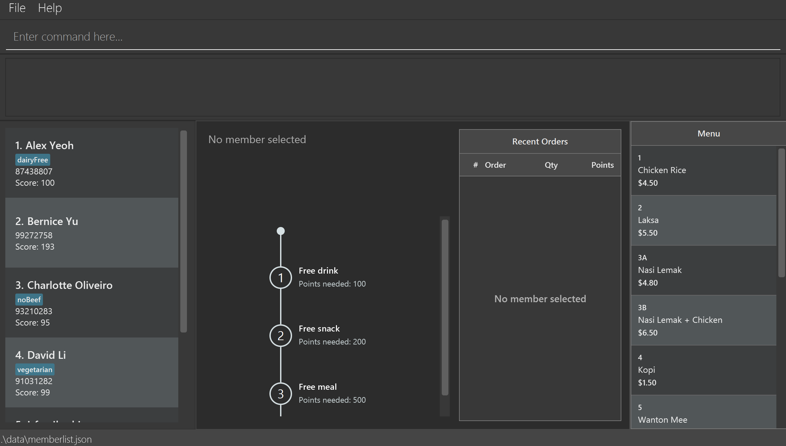

AddressBook Level 3 (AB3) is a **desktop application for managing contacts, optimized for use through a Command Line Interface (CLI)** while retaining the benefits of a Graphical User Interface (GUI). If you type quickly, AB3 can help you manage contacts faster than traditional GUI applications.

* Table of Contents
{:toc}

--------------------------------------------------------------------------------------------------------------------

## Quick start

1. Ensure that Java `25` or later is installed on your computer.<br>
   **Mac users:** Ensure you have the precise JDK version prescribed [here](https://se-education.org/guides/tutorials/javaInstallationMac.html).

1. Download the latest `.jar` file from [here](https://github.com/se-edu/addressbook-level3/releases).

1. Copy the file to the folder you want to use as the _home folder_ for your AddressBook.

1. Open a terminal, `cd` to the folder containing the JAR file, and run `java -jar addressbook.jar`.<br>
   A GUI similar to the one below should appear in a few seconds. Note how the app contains some sample data.<br>
   

1. Type a command in the command box and press Enter to execute it. For example, type **`help`** and press Enter to open the help window.<br>
   Some example commands you can try:

   * `list` : Lists all contacts.

   * `add n/John Doe p/98765432` : Adds a contact named `John Doe` to the Address Book.

   * `add-menu-item c/12A n/Dessert p/3.50` : Adds Dessert to the menu at $3.50.

   * `update-menu-item 12A c/12B p/4.00` : Updates Dessert's code and price.

   * `add-milestone r/Free drink s/500` : Adds a milestone reward that requires 500 points.

   * `list-milestones` : Lists all milestone rewards with their current indexes.

   * `add-order 1 o/1 q/2` : Records an order of two Chicken Rice for the 1st contact shown.

   * `delete-order 1 o/2` : Deletes the 2nd order from the 1st contact shown.

   * `delete 3` : Deletes the 3rd contact shown in the current list.

   * `update-score 1 s/10` increases the score of the 1st person shown by 10.

   * `clear` : Deletes all contacts.

   * `exit` : Exits the app.

1. Refer to the [Features](#features) section below for details of each command.

--------------------------------------------------------------------------------------------------------------------

## Features

<div markdown="block" class="alert alert-info">

**:information_source: Notes about the command format:**<br>

* Words in `UPPER_CASE` are the parameters to be supplied by the user.<br>
  For example, in `add n/NAME`, replace `NAME` with a value such as `John Doe`.

* Items in square brackets are optional.<br>
  For example, `n/NAME [t/TAG]` can be used as `n/John Doe t/friend` or as `n/John Doe`.

* Items followed by `…`​ can appear zero or more times.<br>
  For example, `[t/TAG]…​` may be omitted, or written as `t/friend` or `t/friend t/family`.

* Parameters can be in any order.<br>
  For example, if the command specifies `n/NAME p/PHONE_NUMBER`, `p/PHONE_NUMBER n/NAME` is also acceptable.

* Extraneous parameters for commands that take no parameters, such as `help`, `list`, `exit`, and `clear`, are ignored.<br>
  For example, `help 123` is interpreted as `help`.

* If you are using a PDF version of this document, be careful when copying and pasting commands that span multiple lines as space characters surrounding line-breaks may be omitted when copied over to the application.
</div>

### Viewing help: `help`

Shows a message explaining how to access the help page.


Format: `help`


### Adding a person: `add`

Adds a person to the address book.

* A phone entry is required. Empty or whitespace-only entries are rejected.
* Recognized Singapore numbers contain eight digits starting with 6, 8 or 9. Spaces and hyphens between
  digit groups are accepted. A country prefix of `+65`, `65`, `(+65)` or `(65)` is also accepted.
  These entries are saved as the same eight-digit number; full-width versions of these characters are accepted too.
  A bare `65` is treated as a country prefix only when followed by an otherwise recognized eight-digit number.
* Other nonblank entries, including overseas numbers, unusual lengths, notes and multiple numbers, are saved
  as entered apart from surrounding whitespace. They show the same **nonblocking warning** after a successful
  add or edit. The app does not verify whether any number is assigned or reachable. Hover over a phone label to read the full
  entry if it is shortened in the member list or profile.
* Each saved phone entry identifies one person. People can share a name if their phone entries differ.
  If the entry is already registered, the command rejects it and identifies the existing person, even if that
  person is hidden by a search. Recognized Singapore formats are compared after normalization.
* For all other entries, duplicate detection uses exact, case-sensitive text after removing surrounding whitespace.
  The app does not infer foreign country codes or compare individual numbers inside a note or a list.
  For example, `（86）12345678` and `+8612345678` are treated as different entries.
* Command prefixes such as `n/`, `p/` and `t/` still delimit fields and cannot be embedded literally in a phone
  value when preceded by whitespace.

Phone input examples (assuming the saved entry is not already registered):

| Value after `p/` | Saved phone entry | Result |
|---|---|---|
| `91234567`, `9123 4567`, `9123-4567` | `91234567` | Success |
| `+6591234567`, `+65 9123 4567`, `65 9123 4567`, `6591234567` | `91234567` | Success |
| `(+65) 9123 4567`, `（＋６５）９１２３－４５６７` | `91234567` | Success |
| `12345678`, `911`, `912345678` | Unchanged | Success with warning |
| `+86 138119828111`, `（86）12345678` | Unchanged | Success with warning |
| `91234567 (HP)`, `1234 5678 (HP) 1111-3333 (Office)` | Unchanged | Success with warning |
| `006591234567`, `+65 12345678`, `---` | Unchanged | Success with warning |
| Empty or only whitespace | Not saved | Error: `Phone numbers must not be blank` |

The warning is:

> Warning: This phone entry was not recognized as a standard Singapore number. It has been saved; please check it.
> You may ignore this warning for an overseas number or an intentional special format.
> Duplicate detection for these entries uses exact text only.

Format: `add n/NAME p/PHONE_NUMBER [t/TAG]…​`

<div markdown="span" class="alert alert-primary">:bulb: **Tip:**
A person can have any number of tags, including zero.
</div>

Examples:
* `add n/John Doe p/98765432`
* `add n/Betsy Crowe t/friend p/81234567 t/criminal`

### Listing all persons: `list`

Shows a list of all persons in the address book.

Format: `list`

### Editing a person: `edit`

Edits an existing person in the address book.

Format: `edit INDEX [n/NAME] [p/PHONE] [t/TAG]…​`

* Edits the person at the specified `INDEX`. The index refers to the index number shown in the displayed person list. The index **must be a positive integer** 1, 2, 3, …​
* At least one of the optional fields must be provided.
* Existing values will be updated to the input values.
* Phone numbers follow the same format and uniqueness rules as `add`. Changing a phone number to one already
  registered to another person is rejected; keeping the person's current number is allowed.
* When editing tags, all of the person's existing tags are removed; adding tags is not cumulative.
* To remove all of a person's tags, enter `t/` without a tag after it.

Examples:
*  `edit 1 p/91234567` Edits the phone number of the 1st person to be `91234567`.
*  `edit 2 n/Betsy Crower t/` Edits the name of the 2nd person to be `Betsy Crower` and clears all existing tags.

### Adding a menu item: `add-menu-item`

Adds a food item with a unique code, name, and price to the menu. The item is saved for future sessions.
On a fresh installation, the menu starts with sample items such as `1` (Chicken Rice), `3A` (Nasi Lemak),
and `3B` (Nasi Lemak + Chicken).

Format: `add-menu-item c/CODE n/NAME p/PRICE`

* Provide all three prefixes exactly once. They may appear in any order, separated by spaces or tabs.
* `CODE` must contain one or more letters (`A`–`Z`, `a`–`z`) or digits (`0`–`9`), without spaces or punctuation.
* Codes are case-sensitive: `3A` and `3a` identify different items. A code already in the menu cannot be reused,
  even if the new name or price differs. Different codes may have the same item name.
* `NAME` must not be blank. Spaces, punctuation, and non-English characters are accepted.
* Single-letter prefixes such as `c/`, `n/`, and `p/` are interpreted as arguments when preceded by a space or tab;
  avoid these tokens inside names. Unsupported single-letter prefixes such as `x/` are rejected.
* `PRICE` is in dollars, from `0.01` to `21474836.47`, inclusive. Use digits with up to two decimal places;
  `4`, `4.5`, and `4.50` are accepted. Enter `0.50` for fifty cents, without a currency symbol.
* Missing fields, repeated prefixes, invalid values, and control characters such as newlines are rejected.

Examples:

* `add-menu-item c/12A n/Dessert p/3.50`
* `add-menu-item p/1.20 n/Coffee c/12B`

The first example shows `New menu item added: Dessert` after saving succeeds. The customer list stays as it is;
`list` displays customers, not the menu. Menu items are stored separately, and `clear` does not delete them.

Common errors:

| Input | Result and recovery |
|---|---|
| Reusing `c/12A` after adding that code | `A menu item with this code already exists.` Choose a different code. |
| `add-menu-item c/13 n/Dish` | The command format is shown. Supply the missing `p/PRICE`. |
| `add-menu-item c/13 n/Dish p/4.501` | The price constraint is shown. Use at most two decimal places. |
| `add-menu-item c/13 n/Dish p/0` | The price constraint is shown. Use a positive price of at least `0.01`. |

These validation failures leave the existing menu unchanged and do not save either data file.

### Deleting a menu item: `delete-menu-item`

Deletes the menu item with the specified code and saves the updated menu.

Format: `delete-menu-item c/CODE`

* Provide `c/` exactly once, with a nonblank alphanumeric code. Extra arguments are rejected.
* Codes are case-sensitive. Deleting `CR01` leaves an item with code `cr01` unchanged.
* If the code does not exist, the app shows `No menu item with this code exists.` and leaves the menu unchanged.
* Successful deletion shows, for example, `Deleted menu item: CR01 (Chicken Rice)`.
* Customer records, existing order histories, and milestone rewards are unchanged. The deleted code can be reused.

Example: `delete-menu-item c/CR01`

### Updating a menu item: `update-menu-item`

Updates an existing menu item using its current code. The item is saved for future sessions.

Format: `update-menu-item CURRENT_CODE [c/NEW_CODE] [n/NAME] [p/PRICE]`

* `CURRENT_CODE` identifies the existing menu item. It must contain one or more letters (`A`–`Z`, `a`–`z`) or
  digits (`0`–`9`), without spaces or punctuation.
* `c/NEW_CODE` changes the item's code. The new code must be alphanumeric and must not already exist in the menu.
* `n/NAME` changes the item's name. The name must not be blank.
* `p/PRICE` changes the item's price. Prices use the same dollar format as `add-menu-item`.
* At least one of `c/NEW_CODE`, `n/NAME`, or `p/PRICE` must be provided. They may appear in any order.
* Fields that are not provided retain their existing values.

Examples:

* `update-menu-item 12A n/Chocolate Cake` changes only the name.
* `update-menu-item 12A p/4.00` changes only the price.
* `update-menu-item 12A c/12B n/Chocolate Cake p/4.00` changes the code, name, and price.

Common errors:

| Input | Result and recovery |
|---|---|
| `update-menu-item UNKNOWN n/Dish` | `A menu item with this code does not exist.` Enter the current code of an existing item. |
| `update-menu-item 12A c/3A` | `A menu item with the new code already exists.` Choose a code that is not already in the menu. |
| `update-menu-item 12A` | The command format is shown. Supply at least one field to update. |
| `update-menu-item 12A p/4.001` | The price constraint is shown. Use at most two decimal places. |

Validation failures leave the existing menu item unchanged.

### Listing milestone rewards: `list-milestones`

Lists all milestone rewards with the index used by `edit-milestone` and `delete-milestone`.

Format: `list-milestones`

Milestones are ordered by required score from lowest to highest. Milestones with the same required score may appear
in either order. Each entry shows its index, reward description, and required score. If the catalog is empty, the
command displays `No milestones found.`

Example output:

```text
2 milestone(s) listed!
1. Free drink (Required score: 500)
2. $10 voucher (Required score: 1000)
```

### Adding a milestone reward: `add-milestone`

Adds a milestone reward with a reward description and required score to the milestone catalog.

Format: `add-milestone r/REWARD s/REQUIRED_SCORE`

* Provide both prefixes exactly once. They may appear in any order, separated by spaces or tabs.
* `REWARD` must not be blank. Spaces, punctuation, and non-English characters are accepted.
* `REQUIRED_SCORE` must be a positive whole number from `1` to `2147483647`. Do not include a leading `+` sign.
* Single-letter prefixes such as `r/` and `s/` are interpreted as arguments when preceded by a space or tab;
  avoid these tokens inside reward descriptions. Unsupported prefixes and control characters are rejected.

Examples:

* `add-milestone r/Free drink s/500`
* `add-milestone s/1000 r/$10 voucher`

A successful command displays the reward and required score, for example
`New milestone added: Free drink (Required score: 500)`. The app generates and stores an internal code to track
redemptions; you do not need to enter or use it.

### Editing a milestone reward: `edit-milestone`

Edits the reward description or required score of an existing milestone.

Format: `edit-milestone INDEX [r/REWARD] [s/REQUIRED_SCORE]`

* `INDEX` is the positive index number shown in the current milestone list.
* Provide at least one of `r/REWARD` or `s/REQUIRED_SCORE`. Existing values for omitted fields are preserved.
* Changing a required score can move the milestone to a different index.
* Entering values that are already stored is accepted and leaves the milestone unchanged.

Examples:

* `edit-milestone 1 r/Free drink and snack`
* `edit-milestone 2 s/1200 r/$15 voucher`

### Deleting a milestone reward: `delete-milestone`

Deletes a milestone from the catalog.

Format: `delete-milestone INDEX`

* `INDEX` is the positive index number shown in the current milestone list.
* Use the latest displayed list because adding or editing a milestone can change the sorted order.
* Deleting a milestone does not change any member's score. Reward-claim records are managed separately.

Example: `delete-milestone 1`

Common milestone-command errors:

| Input | Result and recovery |
|---|---|
| `add-milestone r/Free drink` | The command format is shown. Supply `s/REQUIRED_SCORE`. |
| `add-milestone r/Free drink s/+500` | The required-score constraint is shown. Remove the `+` sign. |
| `add-milestone c/FREE500 r/Free drink s/500` | The command format is shown because codes are generated automatically. |
| `edit-milestone 1` | At least one editable field must be provided. |
| `edit-milestone 1 c/NEWCODE` | The command format is shown because milestone codes cannot be edited. |
| `delete-milestone 999` | The milestone-index error is shown. Use an index in the displayed milestone list. |

Failed milestone commands leave the milestone catalog unchanged. Successful commands are saved in
`data/milestones.json`; `clear` removes customers but does not remove milestone rewards.

### Recording an order: `add-order`

Records an order for a person and adds it to that person's order history.

Format: `add-order INDEX o/ITEM_CODE q/QUANTITY`

* `INDEX` is the positive index number shown in the current person list. Use `list` or `find` to identify the person.
* `ITEM_CODE` must be an existing menu item's case-sensitive code. Add the item with `add-menu-item` first.
  Codes contain only letters and digits, without spaces or punctuation.
* `QUANTITY` must be a positive whole number.
* Provide `o/` and `q/` once each. They can appear in either order.
* The order earns 10 points for each $1 spent (`price × quantity`), rounded down to a whole point. These points are
  added to the person's score. An order that would raise the score above `999999999` is rejected.
* After a successful order, the full person list is shown.

Examples:
* With the sample menu, `add-order 1 o/1 q/2` records two Chicken Rice for the 1st person shown and adds 90 points
  to their score ($4.50 × 2 × 10).
* With the sample menu, `add-order 2 q/1 o/3B` records one Nasi Lemak + Chicken for the 2nd person shown.

An unknown code shows `The item code is not in the menu.` and leaves the person's history unchanged. Each order saves
the code, the menu item's name at the time of the order, the quantity, the recorded time, and `scoreGained`. The
order history shows the saved name and points gained for each order, even if the menu item's name later changes. The
saved `scoreGained` also stays the same if the menu price changes.

### Deleting an order: `delete-order`

Deletes an order from a person's order history.

Format: `delete-order INDEX o/ORDER_INDEX`

* `INDEX` is the positive index number shown in the current person list. Use `list` or `find` to identify the person.
* `ORDER_INDEX` is the positive index number of the order in that person's order history, counted from the oldest order.
* Provide `o/` exactly once.
* Deleting an order subtracts its saved `scoreGained` from the person's score. If this would make the score negative,
  the deletion is rejected; update the person's score first if needed.
* After a successful deletion, the full person list is shown.

Examples:
* `delete-order 1 o/2` deletes the 2nd-oldest order from the 1st person shown.
* `find Betsy` followed by `delete-order 1 o/1` deletes Betsy's oldest order.

### Updating a person's score: `update-score`

Updates a person's membership score by the specified amount.

Format: `update-score INDEX s/SCORE_CHANGE`

* `INDEX` is the positive index number shown in the current person list. Use `list` or `find` to identify the person.
* `SCORE_CHANGE` must be a signed whole number. Positive values increase the score, while negative values decrease it.
* The resulting score must be between 0 and 999999999, inclusive.
* After a successful update, the previous and new scores are shown.

Examples:
* `update-score 1 s/10` increases the score of the 1st person shown by 10.
* `update-score 1 s/-5` decreases the score of the 1st person shown by 5.

### Redeeming a milestone: `redeem`

Redeems an available milestone reward for a person who has sufficient membership points.

Format: `redeem INDEX m/MILESTONE_INDEX`

* `INDEX` is the positive index number shown in the current person list.
* `MILESTONE_INDEX` is the positive index number shown in the current milestone list.
* The person must have enough membership points for the selected milestone.
* A person cannot redeem the same milestone more than once.
* Redemption uses the current milestone catalog. Therefore, the selected index refers to the milestone currently
  displayed at that position. If milestones are added, deleted, or reordered, the same index may refer to a different
  milestone. This is intentional because the command identifies milestones by their current displayed index.

Example:
* `redeem 1 m/2` redeems the 2nd milestone for the 1st person shown.

### Cancelling a redeemed milestone: `cancel-redeem`

Cancels a milestone reward that has already been redeemed by a person.

Format: `cancel-redeem INDEX m/MILESTONE_INDEX`

* `INDEX` is the positive index number shown in the current person list.
* `MILESTONE_INDEX` is the positive index number shown in the current milestone list.
* The selected milestone must already be present in that person's redeemed milestone history.
* Cancellation uses the current milestone catalog. Therefore, the milestone's current catalog entry must still exist
  and have the same internal code as the redeemed milestone. If the milestone was deleted, it cannot
  be cancelled through this command. This is intentional because the command identifies milestones by their current
  displayed index.

Example:
* `cancel-redeem 1 m/2` cancels the 2nd currently displayed milestone for the 1st person shown.

Common errors:

| Input | Result and recovery |
|---|---|
| `cancel-redeem 1 m/99` | The milestone index is invalid. Use the current milestone list to choose an index. |
| `cancel-redeem 1 m/2` when milestone 2 was not redeemed by person 1 | `Unable to unredeem because it was not redeemed.` |

Cancellation does not refund or change the person's membership points. It only removes the matching milestone from
the person's redeemed milestone reward history.

### Locating persons by name or phone number: `find`

Finds persons by name keywords or an exact phone entry.

Formats: `find KEYWORD [MORE_KEYWORDS]` or `find p/PHONE_ENTRY`

* Name searches are case-insensitive and match whole words; `hans` matches `Hans`, but `Han` does not.
* Without `p/`, each keyword searches names and complete phone entries. Matching at least one keyword is enough
  (an `OR` search); `Hans Bo` returns `Hans Gruber` and `Bo Yang`, regardless of keyword order.
* If the whole unprefixed query is a recognized Singapore phone format, it is treated as a single normalized
  phone keyword. For example, `find 9123 4567` searches for `91234567`.
* Use `find p/PHONE_ENTRY` to search only phone entries, including an overseas number or a note containing spaces.
  Everything after this first `p/` belongs to one phone query. Recognized Singapore formats are normalized as for
  `add`; other entries require an exact, case-sensitive match, including internal spaces and punctuation.
  Partial phone entries do not match.
* Searches do not change the stored phone entry or show a phone-format warning.

Examples:
* `find John` returns `john` and `John Doe`.
* `find +65 9876 5432` finds the member whose saved phone entry is `98765432`.
* `find p/+86 138119828111` finds that exact overseas entry.
* `find p/（86）12345678` finds that exact entry, not `+8612345678`.
* `find alex david` returns `Alex Yeoh` and `David Li`.

### Deleting a person: `delete`

Deletes the specified person from the address book.

Format: `delete INDEX`

* Deletes the person at the specified `INDEX`.
* The index refers to the index number shown in the displayed person list.
* The index **must be a positive integer** 1, 2, 3, …​

Examples:
* `list` followed by `delete 2` deletes the 2nd person in the address book.
* `find Betsy` followed by `delete 1` deletes the 1st person in the results of the `find` command.

### Clearing all entries: `clear`

Clears all entries from the address book.

Format: `clear`

### Exiting the program: `exit`

Exits the program.

Format: `exit`

### Saving the data

The app automatically saves customer records, the menu, and the milestone catalog after every command that executes
successfully. You do not need to save manually. All three are loaded again at startup.

If a save fails, an error is shown instead of the normal success feedback. Changes already made remain in memory;
after fixing the file-access problem, run a command such as `list` to attempt saving again before closing the app.

### Editing the data file

Customer records are saved in `data/memberlist.json`, menu items in `data/menu.json`, and milestone rewards in
`data/milestones.json`. These paths are relative to the directory from which you launch the app. With the quick-start
instructions above, this is the JAR's folder. Advanced users can edit these files while the app is closed.

Customer records contain a name, phone number, tags, score, and order history.
Unknown properties in older data files are ignored and omitted the next time the data is saved.
Each entry in `orderHistory` uses `itemCode` (for example, `"itemCode": "3A"`), `itemName`, `quantity`,
`recordedAt`, and `scoreGained` (a non-negative whole number of points). `itemName` is the name recorded with that
order, not a live lookup from the menu. Older orders without `scoreGained` load with zero points. If an existing file
lacks either `itemCode` or `itemName`, back it up and add the missing field to each order before opening this version.
Use the corresponding menu item's code or name where possible. Orders missing either field cannot be loaded.

In `menu.json`, each entry in `foodItems` has a string `code`, a string `name`, and a positive integer
`priceInCents`. For example, the command price `p/4.50` is saved as `"priceInCents": 450`.

In `milestones.json`, each entry in `milestones` has an automatically generated, non-blank string `code`, a non-blank
string `rewardDescription`, and a positive integer `requiredScore`. Existing milestone codes remain valid when
loading older data. The internal codes are case-insensitive, saved in uppercase, and must be unique.

<div markdown="span" class="alert alert-warning">:exclamation: **Caution:**
If an existing customer file cannot be loaded, startup stops to protect it from being overwritten. Back it up,
then restore a valid copy or correct the invalid fields before restarting. Old nonblank phone entries still load,
but entries that normalize to the same Singapore number conflict: resolve those duplicate member records in a
backup copy, preserving their points and histories, before upgrading. The app does not merge records automatically.
A missing customer file loads sample contacts. Missing menu or milestone files load their sample data; invalid
menu or milestone files use empty catalogs. A subsequent command can overwrite those invalid catalog files,
so back up all three files before editing them.<br>
Furthermore, certain edits can cause the AddressBook to behave in unexpected ways (e.g., if a value entered is outside of the acceptable range). Therefore, edit the data file only if you are confident that you can update it correctly.
</div>

### Archiving data files `[coming in v2.0]`

_Details coming soon ..._

--------------------------------------------------------------------------------------------------------------------

## FAQ

**Q**: How do I transfer my data to another computer?<br>
**A**: Install the app on the other computer. With both apps closed, copy `data/memberlist.json`, `data/menu.json`,
and `data/milestones.json` from the old home folder into the new home folder's `data` directory.

--------------------------------------------------------------------------------------------------------------------

## Known issues

1. **When using multiple screens**, if you move the application to a secondary screen, and later switch to using only the primary screen, the GUI will open off-screen. The remedy is to delete the `preferences.json` file created by the application before running the application again.
2. **If you minimize the Help Window** and then run the `help` command (or use the `Help` menu, or the keyboard shortcut `F1`) again, the original Help Window will remain minimized, and no new Help Window will appear. The remedy is to manually restore the minimized Help Window.

--------------------------------------------------------------------------------------------------------------------

## Command summary

Action | Format, Examples
--------|------------------
**Add** | `add n/NAME p/PHONE_NUMBER [t/TAG]…​` <br> e.g., `add n/James Ho p/82224444 t/friend t/colleague`
**Delete menu item** | `delete-menu-item c/CODE`<br> e.g., `delete-menu-item c/CR01`
**Add menu item** | `add-menu-item c/CODE n/NAME p/PRICE`<br> e.g., `add-menu-item c/12A n/Dessert p/3.50`
**Update menu item** | `update-menu-item CURRENT_CODE [c/NEW_CODE] [n/NAME] [p/PRICE]`<br> e.g., `update-menu-item 12A c/12B p/4.00`
**Add milestone** | `add-milestone r/REWARD s/REQUIRED_SCORE`<br> e.g., `add-milestone r/Free drink s/500`
**Clear** | `clear`
**Delete** | `delete INDEX`<br> e.g., `delete 3`
**Delete milestone** | `delete-milestone INDEX`<br> e.g., `delete-milestone 1`
**Edit** | `edit INDEX [n/NAME] [p/PHONE_NUMBER] [t/TAG]…​`<br> e.g., `edit 2 n/James Lee`
**Edit milestone** | `edit-milestone INDEX [r/REWARD] [s/REQUIRED_SCORE]`<br> e.g., `edit-milestone 1 s/600`
**Find** | `find KEYWORD [MORE_KEYWORDS]`<br> e.g., `find James Jake`
**List** | `list`
**List milestones** | `list-milestones`
**Update score** | `update-score INDEX s/SCORE_CHANGE`<br> e.g., `update-score 1 s/10`
**Redeem milestone** | `redeem INDEX m/MILESTONE_INDEX`<br> e.g., `redeem 1 m/2`
**Cancel redeemed milestone** | `cancel-redeem INDEX m/MILESTONE_INDEX`<br> e.g., `cancel-redeem 1 m/2`
**Help** | `help`
